<!--
author:   Maia Lust
version:  2.0.0
language: et
comment:  Eesti keel teise keelena, 8. klass (B1–B2): interaktiivsed ülesanded teemade kaupa – kirjutamine, lugemine, keelestruktuur. Litsents CC BY-SA.
logo:     logo.png

@style
/* Tallinna Pae Gümnaasiumi värvid: tumesinine 0,42,92 ja oranž 226,122,63 */
:root, :root[class] {
  --color-highlight: 0,42,92 !important;
  --color-highlight-dark: 0,30,70 !important;
  --color-highlight-menu: 0,42,92 !important;
}
main h1, main h2, main h3, main h4 { color: rgb(0,42,92) !important; }
main h1, main h2, main h3 { border-bottom: 4px solid rgb(226,122,63); padding-bottom: .25em; }
main h4 { border-left: 8px solid rgb(226,122,63); padding-left: .5em; }
main strong { color: rgb(0,42,92); }
.lia-quiz__check { background: rgb(226,122,63) !important; border-color: rgb(226,122,63) !important; color: #fff !important; font-weight: 600; }
.lia-quiz__check:hover { background: rgb(0,42,92) !important; border-color: rgb(0,42,92) !important; }
.lia-dropdown, .lia-quiz input[type=text], .lia-input, textarea { border-color: rgb(0,42,92) !important; }
.lia-dropdown__selected { color: rgb(0,42,92); font-weight: 600; }
.lia-dropdown__option:hover { background: rgba(226,122,63,.18) !important; }
main blockquote { border-left: 6px solid rgb(226,122,63) !important; background: rgba(226,122,63,.08) !important; }
.pae-logo { display: block; width: 220px; max-width: 60%; margin: 0 auto 1em auto; }
input.lia-quiz__input { min-width: 9em !important; width: 9em !important; }
@end
-->

# Eesti keel teise keelena – 8. klass

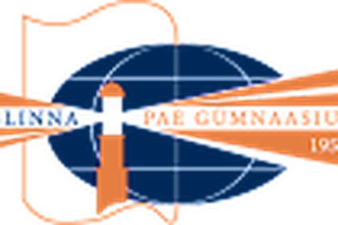

Siin on interaktiivsed ülesanded seitsmel teemal. Iga teema juures on kolm osa:

- **Kirjutamine** – kirjuta kiri ja kokkuvõte otse kasti. Tekst jääb ainult sinu brauserisse, seega kopeeri see ja esita õpetajale. Neid ülesandeid hindab õpetaja.
- **Lugemine** – vali õige vastus. Pärast „Kontrolli” vajutamist näed kohe, kas vastus on õige.
- **Keelestruktuur** – vali sobiv sõna või kirjuta sõna õige vorm. Ka siin saad vastust kohe kontrollida.

Iga teema alguses on ka PDF-töölehed, kui tahad ülesandeid paberil teha.

_Töölehtede autor: M. Lust · CC BY-SA. E-eksami näidisülesanded: Haridus- ja Noorteamet (EIS)._

## Ilm, reisimine ja matkamine

**Töölehed PDF-ina (printimiseks):** [Kirjutamine](ilm_kirjutamine.pdf) · [Lugemine A](ilm_lugemine_A.pdf) · [Lugemine B](ilm_lugemine_B.pdf) · [Keelestruktuur A](ilm_keelestruktuur_A.pdf) · [Keelestruktuur B](ilm_keelestruktuur_B.pdf) · [Vestluskaardid](ilm_raakimine_vestluskaardid.pdf) · [Kõik koos](ilm_koik_toolehed.pdf)

### Kirjutamine

#### 1. ülesanne: kiri

**Loe ülesannet ja kirjuta oma vastus allolevasse kasti.**

Kujuta ette, et käisid klassiga kahepäevasel matkal Soomaal. Sinu sõber oli haige ja ei saanud matkale tulla. Ta tahab nüüd teada, kuidas matk läks. Loe tema kirja ja vasta sellele noolega näidatud märkmete järgi. Kasuta kõiki märkmeid. **Teksti pikkus peab olema u 100 sõna.**

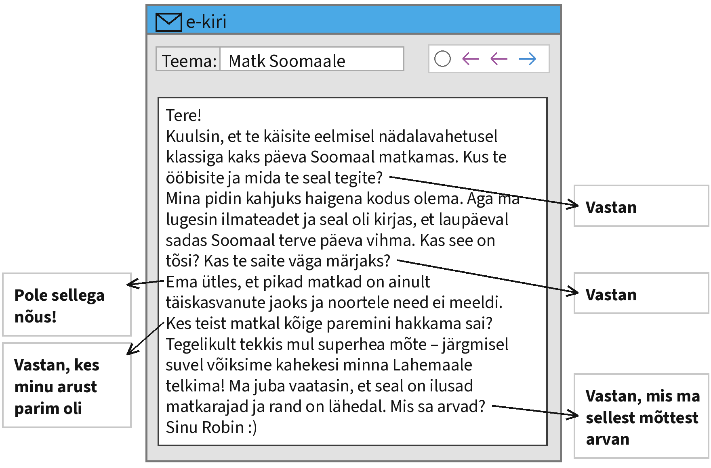

Kirjuta oma kiri siia:

[[___ ___ ___ ___ ___ ___ ___ ___ ___ ___ ___ ___]]

> **Kontrolli enne, kui vajutad „Saada”:** kas vastasid kõigile noolega näidatud märkmetele? Kas kirjas on pöördumine ja lõpetus? Kas tekstis on umbes 100 sõna?

> **NB!** Sinu tekst salvestub ainult sinu enda brauserisse. Õpetaja seda siit ei näe. Kopeeri valmis tekst ja esita see nii, nagu õpetaja ütleb.

#### 2. ülesanne: kokkuvõte diagrammi põhjal

**Loe ülesannet ja kirjuta kokkuvõte allolevasse kasti.**

Kujuta ette, et teie kooli õpilasesindus korraldas 2026. aasta septembris küsitluse, milles osales 240 õpilast 7.–9. klassist. Näed allpool küsitluse tulemusi diagrammil. Kirjuta nende tulemuste põhjal tekst, milles

- tee vastustest kokkuvõte;
- analüüsi, miks veetsid nii paljud õpilased suve peamiselt kodus (mõtle ka ilmale);
- kirjuta, kas eelistad reisida Eestis või välismaal ja miks;
- arutle, kuidas võiks kool õpilasi rohkem matkama ja loodusesse kutsuda.

**Teksti nõutav pikkus on u 160 sõna.**

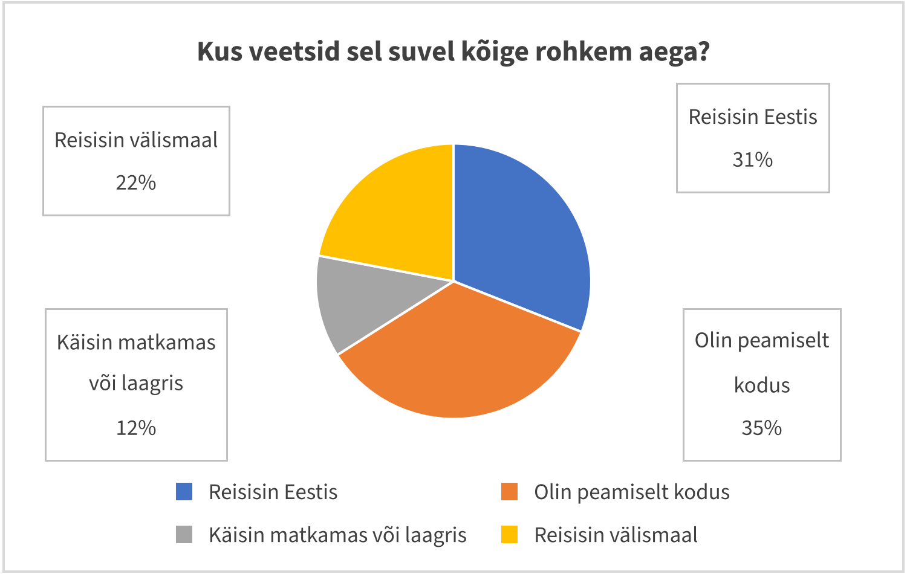

Kirjuta oma kokkuvõte siia:

[[___ ___ ___ ___ ___ ___ ___ ___ ___ ___ ___ ___ ___ ___ ___ ___]]

> **Kontrolli enne, kui vajutad „Saada”:** kas kirjutasid kõigist neljast punktist? Kas kasutasid diagrammi arve? Kas tekstis on umbes 160 sõna?

> **NB!** Sinu tekst salvestub ainult sinu enda brauserisse. Õpetaja seda siit ei näe. Kopeeri valmis tekst ja esita see nii, nagu õpetaja ütleb.

### Lugemine

Lugemisosas on neli ülesannet. Iga ülesanne on eraldi lehel.

#### 2.1 Vestlus

**Täienda Mia ja Oskari vestlust. Kaks vastust jääb üle. Esimene vastus on näidis ja see lünk on juba täidetud.**

_Vali iga vastuse jaoks rippmenüüst sobiv lause ja vajuta „Kontrolli”._

**Mia:** Tere, Oskar! Lõpuks ometi võtsid kõne vastu. Kus sa terve päeva olid?

**Oskar:** _Tere! Olin isaga Kõrvemaal matkamas ja metsas polnud telefonil levi._ (näidis)

**Mia:** Matkamas? Aga eile õhtul lubas ilmateade ju tormi!

**Oskar:** 1. [[ Umbes kaksteist kilomeetrit. Me kõndisime üle raba mööda laudteed. | Ei, ma ei saa homme tulla, sest mul on trenn ja palju kodutöid. | Muidugi! Lähme kohe, kui ilmateade lubab päikest. | (Jah, aga torm tuli alles öösel. Päeval oli ainult pilves ja natuke tuuline.) | Mulle meeldib rohkem rannas päevitada kui metsas kõndida. | Ei, me ööbisime RMK metsamajas. Seal oli ahi ja kuivad voodid. | Natuke olen küll. Kõige ilusam oli vaatetorn, kust paistsid rabajärved. ]]

**Mia:** Kas te magasite telgis? See pidi päris hirmus olema.

**Oskar:** 2. [[ Umbes kaksteist kilomeetrit. Me kõndisime üle raba mööda laudteed. | Ei, ma ei saa homme tulla, sest mul on trenn ja palju kodutöid. | Muidugi! Lähme kohe, kui ilmateade lubab päikest. | Jah, aga torm tuli alles öösel. Päeval oli ainult pilves ja natuke tuuline. | Mulle meeldib rohkem rannas päevitada kui metsas kõndida. | (Ei, me ööbisime RMK metsamajas. Seal oli ahi ja kuivad voodid.) | Natuke olen küll. Kõige ilusam oli vaatetorn, kust paistsid rabajärved. ]]

**Mia:** Kui tore! Mina pole kunagi metsamajas ööbinud. Kui pikk teie matkarada oli?

**Oskar:** 3. [[ (Umbes kaksteist kilomeetrit. Me kõndisime üle raba mööda laudteed.) | Ei, ma ei saa homme tulla, sest mul on trenn ja palju kodutöid. | Muidugi! Lähme kohe, kui ilmateade lubab päikest. | Jah, aga torm tuli alles öösel. Päeval oli ainult pilves ja natuke tuuline. | Mulle meeldib rohkem rannas päevitada kui metsas kõndida. | Ei, me ööbisime RMK metsamajas. Seal oli ahi ja kuivad voodid. | Natuke olen küll. Kõige ilusam oli vaatetorn, kust paistsid rabajärved. ]]

**Mia:** Kaksteist kilomeetrit? Kas sa väga väsinud ei ole? Mis seal kõige ilusam oli?

**Oskar:** 4. [[ Umbes kaksteist kilomeetrit. Me kõndisime üle raba mööda laudteed. | Ei, ma ei saa homme tulla, sest mul on trenn ja palju kodutöid. | Muidugi! Lähme kohe, kui ilmateade lubab päikest. | Jah, aga torm tuli alles öösel. Päeval oli ainult pilves ja natuke tuuline. | Mulle meeldib rohkem rannas päevitada kui metsas kõndida. | Ei, me ööbisime RMK metsamajas. Seal oli ahi ja kuivad voodid. | (Natuke olen küll. Kõige ilusam oli vaatetorn, kust paistsid rabajärved.) ]]

**Mia:** Ma tahaksin ka kord sinna minna. Kas sa võtaksid mind järgmisel korral kaasa?

**Oskar:** 5. [[ Umbes kaksteist kilomeetrit. Me kõndisime üle raba mööda laudteed. | Ei, ma ei saa homme tulla, sest mul on trenn ja palju kodutöid. | (Muidugi! Lähme kohe, kui ilmateade lubab päikest.) | Jah, aga torm tuli alles öösel. Päeval oli ainult pilves ja natuke tuuline. | Mulle meeldib rohkem rannas päevitada kui metsas kõndida. | Ei, me ööbisime RMK metsamajas. Seal oli ahi ja kuivad voodid. | Natuke olen küll. Kõige ilusam oli vaatetorn, kust paistsid rabajärved. ]]

**Mia:** Väga hea! Siis vaatan nüüd iga päev ilmateadet. Homseni!

#### 2.3 Valikvastused

**Loe teksti ja selle kõrval olevaid küsimusi. Otsusta, milline vastus on õige. Igale küsimusele on üks sobiv vastus. Kõigepealt on näidis ja see on juba ära märgitud.**

_Vali iga küsimuse juures õige vastus ja vajuta „Kontrolli”._

**Matkamine sobib igale aastaajale**

Veel paarkümmend aastat tagasi arvati, et matkamine on ainult suvine hobi. Tänapäeval käivad eestlased matkaradadel aasta läbi. Eestis on tuhandeid kilomeetreid märgistatud matkaradu ning lõkke- ja telkimiskohti leidub igas maakonnas. Kõige populaarsemad on lühikesed rabarajad, mida saab läbida paari tunniga.

Kevadel on looduses palju vaadata. Linnud tulevad soojalt maalt tagasi ja metsas õitsevad esimesed lilled. Kevadmatkal tuleb aga arvestada, et pärast lume sulamist on rabas ja metsas väga märg. Seepärast tasub jalga panna kummikud või veekindlad matkasaapad.

Suvi on matkajate seas kõige armastatum aeg. Päevad on pikad ja öösel saab telgis magada. Kuumal suvepäeval peab aga meeles pidama, et kaasas oleks piisavalt joogivett. Metsas võib olla ka palju sääski ja puuke, mistõttu on hea kanda pikkade varrukatega riideid.

Sügisel on mets värviline ja matkaradadel on vähem inimesi. Paljud ühendavad matkamise seenelkäiguga. Sügisilm muutub aga kiiresti: hommikul võib paista päike, õhtul sadada vihma. Kogenud matkajad ütlevad, et halba ilma ei ole, on ainult valed riided. Seepärast pannakse selga mitu kihti, mida saab vajaduse järgi ära võtta.

Talvine matkamine on viimastel aastatel populaarsemaks muutunud. Lumega on raba eriti ilus ja vaikne. Talvel on päevad aga lühikesed, mistõttu tuleb matkale minna varakult ja võtta kaasa taskulamp. Külmaga on tähtis süüa ja juua sooja.

Ükskõik millisel aastaajal matkale minna, enne teeleasumist tuleb vaadata ilmateadet ja rääkida kodustele, kuhu minnakse. Telefon peab olema laetud, sest metsas ei pruugi alati levi olla. Ja muidugi tuleb kogu prügi metsast kaasa võtta.

**0. Mida arvati matkamisest paarkümmend aastat tagasi?** (näidis)

- Et see on ohtlik hobi.
- **Et see sobib ainult suveks.** ✓
- Et see on kallis hobi.

**1. Millised matkarajad on Eestis kõige populaarsemad?**

[(X)] Lühikesed rabarajad.
[( )] Pikad metsarajad.
[( )] Mereäärsed rattarajad.

**2. Mida tasub kevadmatkale jalga panna?**

[( )] Kergeid spordijalanõusid.
[( )] Sooje talvesaapaid.
[(X)] Kummikuid või veekindlaid saapaid.

**3. Miks on suvel hea kanda pikkade varrukatega riideid?**

[( )] Sest öösel on telgis külm.
[( )] Sest päike on väga kuum.
[(X)] Sest metsas on palju putukaid.

**4. Mida tähendab ütlus „halba ilma ei ole, on ainult valed riided“?**

[( )] Matkariided peavad olema moodsad.
[(X)] Riided peavad sobima igasuguse ilmaga.
[( )] Sügisel ei tohi matkale minna.

**5. Mida tuleb talvematkal teha?**

[(X)] Minna teele hommikul varakult.
[( )] Magada telgis lume peal.
[( )] Võtta kaasa jahedat jooki.

**6. Mida peaks tegema enne igat matka?**

[( )] Ostma uue telefoni.
[( )] Kutsuma kaasa kogenud matkaja.
[(X)] Vaatama ilmateadet.

**7. Milline aastaaeg on teksti järgi matkajate lemmik?**

[( )] Kevad.
[(X)] Suvi.
[( )] Sügis.

#### 2.4 Lünktekst

**Loe katkendit Robini matkapäevikust ja täida tekstis lüngad. Näidis on sobiva vastusevariandiga juba täidetud. Üks vastusevariant jääb üle.**

_Vali iga lünga jaoks rippmenüüst sobiv jätk ja vajuta „Kontrolli”._

**Minu esimene rabamatk**

Eelmisel laupäeval käisin esimest korda elus rabamatkal. Minu klassivend Robin, **kes on matkamisest lausa vaimustuses,** kutsus mind kaasa juba kevadel, aga ma olin seni alati mõne vabanduse leidnud. Ausalt öeldes ei olnud ma kindel, (1) [[ et kuulsin ainult oma samme | (kas ma jaksan nii pikka maad kõndida) | sest ilmateade lubas tugevat tormi | nii hea maitsenud | saab kõndida ka kõige laisem inimene | aga ma ei tahtnud seda Robinile tunnistada | soojema jope selga panema | oli ilusam kui ükski pilt | taevas oli esialgu täiesti hall | et järgmisel korral tulen kaasa ilma vabandusteta | mida ma polnud kunagi varem näinud ]]. Robin naeris ja ütles, et raba ei ole mägi ning laudteel (2) [[ et kuulsin ainult oma samme | kas ma jaksan nii pikka maad kõndida | sest ilmateade lubas tugevat tormi | nii hea maitsenud | (saab kõndida ka kõige laisem inimene) | aga ma ei tahtnud seda Robinile tunnistada | soojema jope selga panema | oli ilusam kui ükski pilt | taevas oli esialgu täiesti hall | et järgmisel korral tulen kaasa ilma vabandusteta | mida ma polnud kunagi varem näinud ]].

Hommik oli udune ja jahe. Ilmateade lubas küll päeva teiseks pooleks päikest, aga (3) [[ et kuulsin ainult oma samme | kas ma jaksan nii pikka maad kõndida | sest ilmateade lubas tugevat tormi | nii hea maitsenud | saab kõndida ka kõige laisem inimene | aga ma ei tahtnud seda Robinile tunnistada | soojema jope selga panema | oli ilusam kui ükski pilt | (taevas oli esialgu täiesti hall) | et järgmisel korral tulen kaasa ilma vabandusteta | mida ma polnud kunagi varem näinud ]]. Bussis istudes mõtlesin, et oleksin pidanud (4) [[ et kuulsin ainult oma samme | kas ma jaksan nii pikka maad kõndida | sest ilmateade lubas tugevat tormi | nii hea maitsenud | saab kõndida ka kõige laisem inimene | aga ma ei tahtnud seda Robinile tunnistada | (soojema jope selga panema) | oli ilusam kui ükski pilt | taevas oli esialgu täiesti hall | et järgmisel korral tulen kaasa ilma vabandusteta | mida ma polnud kunagi varem näinud ]]. Õnneks oli Robinil seljakotis varuks ka teine kampsun.

Kui me rappa jõudsime, unustasin külma kiiresti. Laudtee kulges madalate mändide ja väikeste rabajärvede vahel. Igal pool oli nii vaikne, (5) [[ (et kuulsin ainult oma samme) | kas ma jaksan nii pikka maad kõndida | sest ilmateade lubas tugevat tormi | nii hea maitsenud | saab kõndida ka kõige laisem inimene | aga ma ei tahtnud seda Robinile tunnistada | soojema jope selga panema | oli ilusam kui ükski pilt | taevas oli esialgu täiesti hall | et järgmisel korral tulen kaasa ilma vabandusteta | mida ma polnud kunagi varem näinud ]]. Robin näitas mulle taimi, (6) [[ et kuulsin ainult oma samme | kas ma jaksan nii pikka maad kõndida | sest ilmateade lubas tugevat tormi | nii hea maitsenud | saab kõndida ka kõige laisem inimene | aga ma ei tahtnud seda Robinile tunnistada | soojema jope selga panema | oli ilusam kui ükski pilt | taevas oli esialgu täiesti hall | et järgmisel korral tulen kaasa ilma vabandusteta | (mida ma polnud kunagi varem näinud) ]], ja rääkis, et osa rabast on tuhandeid aastaid vana.

Lõunaks jõudsime vaatetorni juurde. Ronisin üles ja jäin lihtsalt seisma, sest vaade (7) [[ et kuulsin ainult oma samme | kas ma jaksan nii pikka maad kõndida | sest ilmateade lubas tugevat tormi | nii hea maitsenud | saab kõndida ka kõige laisem inimene | aga ma ei tahtnud seda Robinile tunnistada | soojema jope selga panema | (oli ilusam kui ükski pilt) | taevas oli esialgu täiesti hall | et järgmisel korral tulen kaasa ilma vabandusteta | mida ma polnud kunagi varem näinud ]]. Udu oli kadunud ja päike peegeldus järvedes. Sõime torni all võileibu ja jõime termosest kuuma teed. Kunagi varem pole tee mulle (8) [[ et kuulsin ainult oma samme | kas ma jaksan nii pikka maad kõndida | sest ilmateade lubas tugevat tormi | (nii hea maitsenud) | saab kõndida ka kõige laisem inimene | aga ma ei tahtnud seda Robinile tunnistada | soojema jope selga panema | oli ilusam kui ükski pilt | taevas oli esialgu täiesti hall | et järgmisel korral tulen kaasa ilma vabandusteta | mida ma polnud kunagi varem näinud ]].

Tagasiteel hakkas jalg veidi valutama, (9) [[ et kuulsin ainult oma samme | kas ma jaksan nii pikka maad kõndida | sest ilmateade lubas tugevat tormi | nii hea maitsenud | saab kõndida ka kõige laisem inimene | (aga ma ei tahtnud seda Robinile tunnistada) | soojema jope selga panema | oli ilusam kui ükski pilt | taevas oli esialgu täiesti hall | et järgmisel korral tulen kaasa ilma vabandusteta | mida ma polnud kunagi varem näinud ]]. Koju jõudes olin väga väsinud, kuid õnnelik. Nüüd ootan juba järgmist matka ja olen Robinile lubanud, (10) [[ et kuulsin ainult oma samme | kas ma jaksan nii pikka maad kõndida | sest ilmateade lubas tugevat tormi | nii hea maitsenud | saab kõndida ka kõige laisem inimene | aga ma ei tahtnud seda Robinile tunnistada | soojema jope selga panema | oli ilusam kui ükski pilt | taevas oli esialgu täiesti hall | (et järgmisel korral tulen kaasa ilma vabandusteta) | mida ma polnud kunagi varem näinud ]].

#### 2.5 Lausete lõpud

**Lõpeta laused. Üks lause lõpp jääb üle. Esimene lause on näidis ja see on juba ära märgitud.**

_Vali iga lünga jaoks rippmenüüst sobiv jätk ja vajuta „Kontrolli”._

**Valmistume matkaks!**

Reede õhtul helistas klassijuhataja ja ütles, **et laupäevane matk toimub hoolimata vihmast.** Kõigepealt pidin seljakoti pakkima, (1) [[ et neid jätkuks kogu päevaks. | kuid ta oli selleks veel liiga noor. | et olin oma veepudeli koju unustanud. | sest buss oli juba ammu ära sõitnud. | sest metsas ei saa seda kusagil laadida. | (aga ma ei teadnud, mida kaasa võtta.) | kui mul janu hakkas. | millel ta oli noorena mitu korda maganud. | nii et vihmajope jäi seljakotti. | sest märjad jalad on matkal kõige hullem asi. | et teada saada, kas vihm lõpeb enne hommikut. ]] Ema soovitas panna kotti vahetussokid, (2) [[ et neid jätkuks kogu päevaks. | kuid ta oli selleks veel liiga noor. | et olin oma veepudeli koju unustanud. | sest buss oli juba ammu ära sõitnud. | sest metsas ei saa seda kusagil laadida. | aga ma ei teadnud, mida kaasa võtta. | kui mul janu hakkas. | millel ta oli noorena mitu korda maganud. | nii et vihmajope jäi seljakotti. | (sest märjad jalad on matkal kõige hullem asi.) | et teada saada, kas vihm lõpeb enne hommikut. ]] Isa tõi keldrist vana matkamati, (3) [[ et neid jätkuks kogu päevaks. | kuid ta oli selleks veel liiga noor. | et olin oma veepudeli koju unustanud. | sest buss oli juba ammu ära sõitnud. | sest metsas ei saa seda kusagil laadida. | aga ma ei teadnud, mida kaasa võtta. | kui mul janu hakkas. | (millel ta oli noorena mitu korda maganud.) | nii et vihmajope jäi seljakotti. | sest märjad jalad on matkal kõige hullem asi. | et teada saada, kas vihm lõpeb enne hommikut. ]] Väike õde tahtis ka matkale tulla, (4) [[ et neid jätkuks kogu päevaks. | (kuid ta oli selleks veel liiga noor.) | et olin oma veepudeli koju unustanud. | sest buss oli juba ammu ära sõitnud. | sest metsas ei saa seda kusagil laadida. | aga ma ei teadnud, mida kaasa võtta. | kui mul janu hakkas. | millel ta oli noorena mitu korda maganud. | nii et vihmajope jäi seljakotti. | sest märjad jalad on matkal kõige hullem asi. | et teada saada, kas vihm lõpeb enne hommikut. ]] Võileibu tegime terve perega koos, (5) [[ (et neid jätkuks kogu päevaks.) | kuid ta oli selleks veel liiga noor. | et olin oma veepudeli koju unustanud. | sest buss oli juba ammu ära sõitnud. | sest metsas ei saa seda kusagil laadida. | aga ma ei teadnud, mida kaasa võtta. | kui mul janu hakkas. | millel ta oli noorena mitu korda maganud. | nii et vihmajope jäi seljakotti. | sest märjad jalad on matkal kõige hullem asi. | et teada saada, kas vihm lõpeb enne hommikut. ]] Ilmateadet vaatasin mitu korda, (6) [[ et neid jätkuks kogu päevaks. | kuid ta oli selleks veel liiga noor. | et olin oma veepudeli koju unustanud. | sest buss oli juba ammu ära sõitnud. | sest metsas ei saa seda kusagil laadida. | aga ma ei teadnud, mida kaasa võtta. | kui mul janu hakkas. | millel ta oli noorena mitu korda maganud. | nii et vihmajope jäi seljakotti. | sest märjad jalad on matkal kõige hullem asi. | (et teada saada, kas vihm lõpeb enne hommikut.) ]] Telefoni panin öösel laadima, (7) [[ et neid jätkuks kogu päevaks. | kuid ta oli selleks veel liiga noor. | et olin oma veepudeli koju unustanud. | sest buss oli juba ammu ära sõitnud. | (sest metsas ei saa seda kusagil laadida.) | aga ma ei teadnud, mida kaasa võtta. | kui mul janu hakkas. | millel ta oli noorena mitu korda maganud. | nii et vihmajope jäi seljakotti. | sest märjad jalad on matkal kõige hullem asi. | et teada saada, kas vihm lõpeb enne hommikut. ]] Hommikul oli ilm aga ootamatult selge, (8) [[ et neid jätkuks kogu päevaks. | kuid ta oli selleks veel liiga noor. | et olin oma veepudeli koju unustanud. | sest buss oli juba ammu ära sõitnud. | sest metsas ei saa seda kusagil laadida. | aga ma ei teadnud, mida kaasa võtta. | kui mul janu hakkas. | millel ta oli noorena mitu korda maganud. | (nii et vihmajope jäi seljakotti.) | sest märjad jalad on matkal kõige hullem asi. | et teada saada, kas vihm lõpeb enne hommikut. ]] Bussis istudes märkasin, (9) [[ et neid jätkuks kogu päevaks. | kuid ta oli selleks veel liiga noor. | (et olin oma veepudeli koju unustanud.) | sest buss oli juba ammu ära sõitnud. | sest metsas ei saa seda kusagil laadida. | aga ma ei teadnud, mida kaasa võtta. | kui mul janu hakkas. | millel ta oli noorena mitu korda maganud. | nii et vihmajope jäi seljakotti. | sest märjad jalad on matkal kõige hullem asi. | et teada saada, kas vihm lõpeb enne hommikut. ]] Õnneks andis sõber mulle oma joogivett, (10) [[ et neid jätkuks kogu päevaks. | kuid ta oli selleks veel liiga noor. | et olin oma veepudeli koju unustanud. | sest buss oli juba ammu ära sõitnud. | sest metsas ei saa seda kusagil laadida. | aga ma ei teadnud, mida kaasa võtta. | (kui mul janu hakkas.) | millel ta oli noorena mitu korda maganud. | nii et vihmajope jäi seljakotti. | sest märjad jalad on matkal kõige hullem asi. | et teada saada, kas vihm lõpeb enne hommikut. ]]

### Keelestruktuur

Keelestruktuuri osas on kaks ülesannet. Iga ülesanne on eraldi lehel.

#### 2.6 Vali sobiv sõna

**Loe teksti ja vali lünka sobiv sõna. Esimene lünk on näidis ja seal on õige vastus ära valitud.**

_Vali iga lünga jaoks rippmenüüst sobiv sõna ja vajuta „Kontrolli”._

**Eesti ilm üllatab alati**

Eestlased räägivad ilmast meelsasti ja see pole ime, sest Eesti ilm on väga **muutlik**. Juba ühe päeva jooksul võib paista päike, sadada vihma ja [[ puhub | (puhuda) | puhunud ]] tugev tuul.

Eesti asub parasvöötmes, [[ kuhu | kust | (kus) ]] on neli selgelt eristuvat aastaaega. Kõige külmem kuu on tavaliselt veebruar ja kõige soojem [[ (juuli) | juulis | juulit ]]. Läänemeri mõjutab kliimat väga palju: rannikul on talv soojem ja suvi jahedam [[ nagu | (kui) | et ]] sisemaal.

Viimastel aastatel on Eesti talved muutunud [[ pehme | pehmeks | (pehmemaks) ]]. Lumi tuleb hiljem ja sulab varem. Paljudes kohtades ei olegi lastel talvel võimalik [[ (suusatada) | suusatama | suusatab ]], sest lund on liiga vähe. Samas on suvel sagenenud kuumalained ja [[ tugevate | (tugevad) | tugevaid ]] äikesetormid.

Ilmateadet koostavad sünoptikud. Nad [[ kasutab | kasutama | (kasutavad) ]] satelliidipilte ja arvutimudeleid. Lühiajaline prognoos on päris täpne, kuid mitme nädala ilma on võimatu kindlalt [[ ennustanud | (ette ennustada) | ennustamas ]].

Seepärast tasub enne matkale minekut alati [[ (vaadata) | vaatama | vaatab ]] värsket ilmateadet.

#### 2.7 Sõna õige vorm

**Loe teksti ja kirjuta lünka sõna õige vorm. Igas lüngas on antud sõna algvorm, pane see sellisesse vormi, mis sobib teksti. Esimene lünk on näidis: sulgudes on sõna algvorm ja selle kõrval lünka sobiv vorm.**

_Kirjuta sulgudes oleva sõna õige vorm lünka ja vajuta „Kontrolli”._

**Talvematk rabas**

Paljud arvavad, et matkata saab ainult _(soe)_ **soojal** aastaajal. Tegelikult teeb lumi raba veelgi _(ilus)_ [[ilusamaks]].

Eelmisel _(laupäev)_ [[laupäeval]] käisime klassiga Kõrvemaal. Hommikul näitas termomeeter kümme _(kraad)_ [[kraadi]] külma, aga ilmateade lubas päikest, nii et me _(otsustama)_ [[otsustasime]] siiski matkale minna. Bussist väljudes nägime, et kõik _(puu)_ [[puud]] olid paksu lumega kaetud.

Laudtee oli libe, seepärast pidime kõndima väga _(ettevaatlik)_ [[ettevaatlikult]]. Rada kulges madalate _(mänd)_ [[mändide]] vahel ja rabas oli nii vaikne, et kuulsime ainult oma _(samm)_ [[sammude]] krudinat. Lõunaks jõudsime _(vaatetorn)_ [[vaatetorni]] juurde. Sealt avanes imeline vaade _(lumine)_ [[lumisele]] rabale.

## Lähme rändama!

**Töölehed PDF-ina (printimiseks):** [Kirjutamine](lahme_randama_kirjutamine.pdf) · [Lugemine](lahme_randama_lugemine.pdf) · [Keelestruktuur](lahme_randama_keelestruktuur.pdf) · [Kõik koos](lahme_randama_koik_toolehed.pdf)

### Kirjutamine

#### 1. ülesanne: kiri

**Loe ülesannet ja kirjuta oma vastus allolevasse kasti.**

Kujuta ette, et olid suvel perega reisil Lätis. Sinu klassivend Mark oli terve suve kodus. Ta tahab nüüd teada, kuidas sinu reis läks. Loe tema kirja ja vasta sellele noolega näidatud märkmete järgi. Kasuta kõiki märkmeid. **Teksti pikkus peab olema u 100 sõna.**

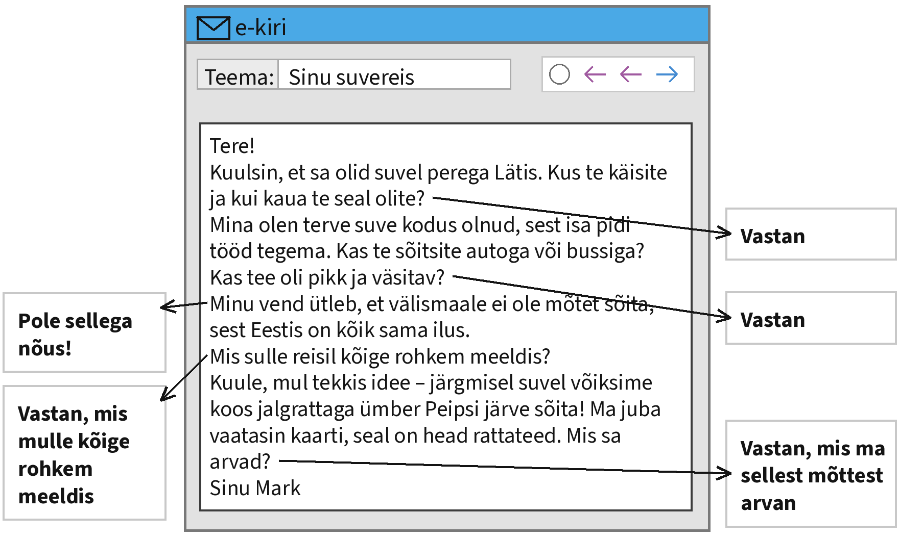

Kirjuta oma kiri siia:

[[___ ___ ___ ___ ___ ___ ___ ___ ___ ___ ___ ___]]

> **Kontrolli enne, kui vajutad „Saada”:** kas vastasid kõigile noolega näidatud märkmetele? Kas kirjas on pöördumine ja lõpetus? Kas tekstis on umbes 100 sõna?

> **NB!** Sinu tekst salvestub ainult sinu enda brauserisse. Õpetaja seda siit ei näe. Kopeeri valmis tekst ja esita see nii, nagu õpetaja ütleb.

#### 2. ülesanne: kokkuvõte diagrammi põhjal

**Loe ülesannet ja kirjuta kokkuvõte allolevasse kasti.**

Kujuta ette, et teie kooli õpilasesindus korraldas 2026. aasta septembris küsitluse, milles osales 180 õpilast 7.–9. klassist. Näed allpool küsitluse tulemusi diagrammil. Kirjuta nende tulemuste põhjal tekst, milles

- tee vastustest kokkuvõte;
- analüüsi, miks sõidavad pered kõige sagedamini autoga;
- kirjuta, millega sulle kõige rohkem meeldib reisida ja miks;
- arutle, kuidas võiks noori rohkem bussi ja rongiga reisima kutsuda.

**Teksti nõutav pikkus on u 160 sõna.**

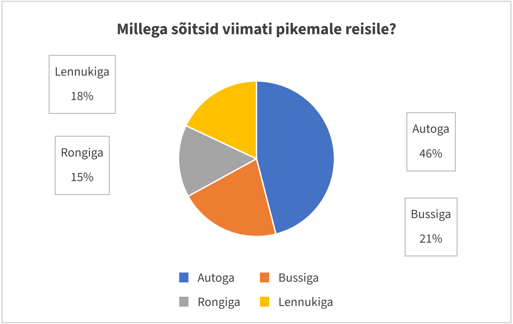

Kirjuta oma kokkuvõte siia:

[[___ ___ ___ ___ ___ ___ ___ ___ ___ ___ ___ ___ ___ ___ ___ ___]]

> **Kontrolli enne, kui vajutad „Saada”:** kas kirjutasid kõigist neljast punktist? Kas kasutasid diagrammi arve? Kas tekstis on umbes 160 sõna?

> **NB!** Sinu tekst salvestub ainult sinu enda brauserisse. Õpetaja seda siit ei näe. Kopeeri valmis tekst ja esita see nii, nagu õpetaja ütleb.

### Lugemine

Lugemisosas on neli ülesannet. Iga ülesanne on eraldi lehel.

#### 2.1 Vestlus

**Täienda Kati ja Robini vestlust. Kaks vastust jääb üle. Esimene vastus on näidis ja see lünk on juba täidetud.**

_Vali iga vastuse jaoks rippmenüüst sobiv lause ja vajuta „Kontrolli”._

**Kati:** Tere, Robin! Kuulsin, et sa olid terve nädala ära. Kus sa käisid?

**Robin:** _Tere! Olin perega Riias. Tulime alles eile õhtul tagasi._ (näidis)

**Kati:** Riias? Kuidas te sinna sõitsite?

**Robin:** 1. [[ Väikeses hotellis vanalinnas. Meie toa aknast paistis Peetri kiriku torn. | (Bussiga. Sõit kestis umbes neli ja pool tundi, aga bussis oli internet ja aeg läks kiiresti.) | Käisime Keskturul, mis asub vanades tsepeliinihangaarides, ja sõime seal Läti pannkooke. | Ei, ma ei ole kunagi Riias käinud, aga tahaksin väga minna. | Pilet maksis kolmkümmend eurot ja selle ostsime internetist. | Kindlasti! Järgmisel kevadel tahaksin minna sinna koos klassiga. | Olen küll, Soomes, aga Riias olin esimest korda. ]]

**Kati:** Neli ja pool tundi! Mina ei jaksaks nii kaua istuda. Kus te ööbisite?

**Robin:** 2. [[ (Väikeses hotellis vanalinnas. Meie toa aknast paistis Peetri kiriku torn.) | Bussiga. Sõit kestis umbes neli ja pool tundi, aga bussis oli internet ja aeg läks kiiresti. | Käisime Keskturul, mis asub vanades tsepeliinihangaarides, ja sõime seal Läti pannkooke. | Ei, ma ei ole kunagi Riias käinud, aga tahaksin väga minna. | Pilet maksis kolmkümmend eurot ja selle ostsime internetist. | Kindlasti! Järgmisel kevadel tahaksin minna sinna koos klassiga. | Olen küll, Soomes, aga Riias olin esimest korda. ]]

**Kati:** Kui ilus! Mida te seal veel tegite?

**Robin:** 3. [[ Väikeses hotellis vanalinnas. Meie toa aknast paistis Peetri kiriku torn. | Bussiga. Sõit kestis umbes neli ja pool tundi, aga bussis oli internet ja aeg läks kiiresti. | (Käisime Keskturul, mis asub vanades tsepeliinihangaarides, ja sõime seal Läti pannkooke.) | Ei, ma ei ole kunagi Riias käinud, aga tahaksin väga minna. | Pilet maksis kolmkümmend eurot ja selle ostsime internetist. | Kindlasti! Järgmisel kevadel tahaksin minna sinna koos klassiga. | Olen küll, Soomes, aga Riias olin esimest korda. ]]

**Kati:** Kas sa oled varem ka välismaal käinud?

**Robin:** 4. [[ Väikeses hotellis vanalinnas. Meie toa aknast paistis Peetri kiriku torn. | Bussiga. Sõit kestis umbes neli ja pool tundi, aga bussis oli internet ja aeg läks kiiresti. | Käisime Keskturul, mis asub vanades tsepeliinihangaarides, ja sõime seal Läti pannkooke. | Ei, ma ei ole kunagi Riias käinud, aga tahaksin väga minna. | Pilet maksis kolmkümmend eurot ja selle ostsime internetist. | Kindlasti! Järgmisel kevadel tahaksin minna sinna koos klassiga. | (Olen küll, Soomes, aga Riias olin esimest korda.) ]]

**Kati:** Kas sa soovitaksid Riiga sõita?

**Robin:** 5. [[ Väikeses hotellis vanalinnas. Meie toa aknast paistis Peetri kiriku torn. | Bussiga. Sõit kestis umbes neli ja pool tundi, aga bussis oli internet ja aeg läks kiiresti. | Käisime Keskturul, mis asub vanades tsepeliinihangaarides, ja sõime seal Läti pannkooke. | Ei, ma ei ole kunagi Riias käinud, aga tahaksin väga minna. | Pilet maksis kolmkümmend eurot ja selle ostsime internetist. | (Kindlasti! Järgmisel kevadel tahaksin minna sinna koos klassiga.) | Olen küll, Soomes, aga Riias olin esimest korda. ]]

**Kati:** Hea mõte! Räägime sellest homme klassijuhatajaga. Head ööd!

#### 2.3 Valikvastused

**Loe teksti ja selle kõrval olevaid küsimusi. Otsusta, milline vastus on õige. Igale küsimusele on üks sobiv vastus. Kõigepealt on näidis ja see on juba ära märgitud.**

_Vali iga küsimuse juures õige vastus ja vajuta „Kontrolli”._

**Seljakotireis – odav ja põnev**

Paljud noored unistavad pärast kooli lõpetamist seljakotireisist. Seljakotireis tähendab, et reisija võtab kaasa ainult ühe suure seljakoti ja liigub kohast kohta odavalt: bussi, rongi või isegi pöidlaküüdiga. Hotellide asemel ööbitakse hostelites, kus ühes toas võib magada kuus või kaheksa inimest.

Seljakotireisi suurim pluss on hind. Kui reisija planeerib hästi, võib ta mitu nädalat reisida sama raha eest, mille teised kulutavad nädalasele puhkusereisile. Raha säästetakse eriti söögi pealt: paljudes hostelites on köök, kus saab ise süüa teha.

Teine pluss on uued tutvused. Hostelites kohtab inimesi üle kogu maailma. Õhtuti istutakse koos köögis, räägitakse reisimuljetest ja antakse üksteisele nõu. Mõnikord jätkatakse teekonda koos.

Seljakotireisil on ka miinuseid. Kuna kõik asjad tuleb ise kanda, ei saa kaasa võtta palju riideid. Hostelis on harva vaikne ja korralikult välja magada on raske. Lisaks peab reisija ise kõige eest hoolitsema: otsima ööbimiskoha, ostma piletid ja jälgima, et dokumendid ja raha oleksid alati turvalises kohas.

Kogenud reisijad soovitavad esimest seljakotireisi teha kodule lähedal. Eesti noorele sobivad selleks hästi näiteks Läti, Leedu ja Soome. Seal on keel ja kombed küll teistsugused, kuid kui midagi juhtub, saab kiiresti koju tagasi.

Enne reisi tasub koostada kava, kuid see ei pea olema väga täpne. Seljakotireisi võlu ongi selles, et iga päev võib tuua ootamatuid üllatusi. Tähtis on ainult, et kodused teaksid, kus reisija parasjagu on.

**0. Mis on seljakotireisile iseloomulik?** (näidis)

- Reisija ööbib alati hotellis.
- **Reisija võtab kaasa ühe suure seljakoti.** ✓
- Reisija sõidab ainult lennukiga.

**1. Kus ööbivad seljakotireisijad tavaliselt?**

[( )] Sugulaste juures.
[( )] Telgis.
[(X)] Hostelites.

**2. Kuidas säästavad seljakotireisijad raha?**

[( )] Nad reisivad ainult nädala.
[( )] Nad ei osta kunagi pileteid.
[(X)] Nad teevad ise süüa.

**3. Mida tehakse hostelis õhtuti?**

[( )] Minnakse varakult magama.
[(X)] Räägitakse reisimuljetest.
[( )] Vaadatakse koos filme.

**4. Miks ei saa seljakotireisile palju riideid võtta?**

[(X)] Sest kõik asjad tuleb ise kanda.
[( )] Sest hostelis pole kappe.
[( )] Sest bussis pole ruumi.

**5. Miks soovitatakse esimest reisi teha kodule lähedal?**

[( )] Sest seal on hostelid tasuta.
[(X)] Sest vajaduse korral saab kiiresti koju.
[( )] Sest seal räägitakse eesti keelt.

**6. Milline peaks olema reisikava?**

[( )] Väga täpne, tund-tunnilt.
[(X)] Mitte väga täpne.
[( )] Kava pole üldse vaja.

**7. Mida peaksid kodused reisi ajal teadma?**

[(X)] Kus reisija parasjagu on.
[( )] Kui palju raha on kulunud.
[( )] Millal reisija sööb.

#### 2.4 Lünktekst

**Loe katkendit Kati reisipäevikust ja täida tekstis lüngad. Näidis on sobiva vastusevariandiga juba täidetud. Üks vastusevariant jääb üle.**

_Vali iga lünga jaoks rippmenüüst sobiv jätk ja vajuta „Kontrolli”._

**Minu esimene lennureis**

Eelmisel suvel lendasin esimest korda elus lennukiga. Me sõitsime perega Itaaliasse, **sest isa oli juba ammu Roomast unistanud**. Ausalt öeldes oli mul natuke hirm, (1) [[ hirm kadus nagu käega pühitud | hoidsin kõvasti tooli käetugedest kinni | miks itaallased keskpäeval puhkavad | kuhu me järgmisel suvel sõidame | et rong jõuab Tartusse kell kümme | mida sai osta kaardiga | panema need eraldi kasti | kuigi ta oli varem öelnud, et pole üldse väsinud | mis kaalus peaaegu kakskümmend kilo | tundus, nagu oleksime astunud sauna | (sest olin kuulnud, et lennukis võib halb hakata) ]]. Ema rahustas mind ja ütles, et lennuk on kõige turvalisem sõiduk.

Lennujaama jõudsime kaks tundi enne väljalendu. Kõigepealt andsime ära kohvri, (2) [[ hirm kadus nagu käega pühitud | hoidsin kõvasti tooli käetugedest kinni | miks itaallased keskpäeval puhkavad | kuhu me järgmisel suvel sõidame | et rong jõuab Tartusse kell kümme | mida sai osta kaardiga | panema need eraldi kasti | kuigi ta oli varem öelnud, et pole üldse väsinud | (mis kaalus peaaegu kakskümmend kilo) | tundus, nagu oleksime astunud sauna | sest olin kuulnud, et lennukis võib halb hakata ]]. Seejärel läksime läbi turvakontrolli. Seal pidin võtma taskust kõik asjad ja (3) [[ hirm kadus nagu käega pühitud | hoidsin kõvasti tooli käetugedest kinni | miks itaallased keskpäeval puhkavad | kuhu me järgmisel suvel sõidame | et rong jõuab Tartusse kell kümme | mida sai osta kaardiga | (panema need eraldi kasti) | kuigi ta oli varem öelnud, et pole üldse väsinud | mis kaalus peaaegu kakskümmend kilo | tundus, nagu oleksime astunud sauna | sest olin kuulnud, et lennukis võib halb hakata ]].

Lennukis sain istuda akna all. Kui lennuk hakkas õhku tõusma, (4) [[ hirm kadus nagu käega pühitud | (hoidsin kõvasti tooli käetugedest kinni) | miks itaallased keskpäeval puhkavad | kuhu me järgmisel suvel sõidame | et rong jõuab Tartusse kell kümme | mida sai osta kaardiga | panema need eraldi kasti | kuigi ta oli varem öelnud, et pole üldse väsinud | mis kaalus peaaegu kakskümmend kilo | tundus, nagu oleksime astunud sauna | sest olin kuulnud, et lennukis võib halb hakata ]]. Aga juba mõne minuti pärast olime pilvede kohal ja (5) [[ (hirm kadus nagu käega pühitud) | hoidsin kõvasti tooli käetugedest kinni | miks itaallased keskpäeval puhkavad | kuhu me järgmisel suvel sõidame | et rong jõuab Tartusse kell kümme | mida sai osta kaardiga | panema need eraldi kasti | kuigi ta oli varem öelnud, et pole üldse väsinud | mis kaalus peaaegu kakskümmend kilo | tundus, nagu oleksime astunud sauna | sest olin kuulnud, et lennukis võib halb hakata ]]. Pilved nägid välja nagu valge vatt.

Lend kestis umbes kolm tundi. Stjuardess pakkus jooke ja võileibu, (6) [[ hirm kadus nagu käega pühitud | hoidsin kõvasti tooli käetugedest kinni | miks itaallased keskpäeval puhkavad | kuhu me järgmisel suvel sõidame | et rong jõuab Tartusse kell kümme | (mida sai osta kaardiga) | panema need eraldi kasti | kuigi ta oli varem öelnud, et pole üldse väsinud | mis kaalus peaaegu kakskümmend kilo | tundus, nagu oleksime astunud sauna | sest olin kuulnud, et lennukis võib halb hakata ]]. Väike vend magas kogu lennu aja, (7) [[ hirm kadus nagu käega pühitud | hoidsin kõvasti tooli käetugedest kinni | miks itaallased keskpäeval puhkavad | kuhu me järgmisel suvel sõidame | et rong jõuab Tartusse kell kümme | mida sai osta kaardiga | panema need eraldi kasti | (kuigi ta oli varem öelnud, et pole üldse väsinud) | mis kaalus peaaegu kakskümmend kilo | tundus, nagu oleksime astunud sauna | sest olin kuulnud, et lennukis võib halb hakata ]].

Roomas oli palju soojem kui Tallinnas. Kui lennukist väljusime, (8) [[ hirm kadus nagu käega pühitud | hoidsin kõvasti tooli käetugedest kinni | miks itaallased keskpäeval puhkavad | kuhu me järgmisel suvel sõidame | et rong jõuab Tartusse kell kümme | mida sai osta kaardiga | panema need eraldi kasti | kuigi ta oli varem öelnud, et pole üldse väsinud | mis kaalus peaaegu kakskümmend kilo | (tundus, nagu oleksime astunud sauna) | sest olin kuulnud, et lennukis võib halb hakata ]]. Isa naeris ja ütles, et nüüd saame aru, (9) [[ hirm kadus nagu käega pühitud | hoidsin kõvasti tooli käetugedest kinni | (miks itaallased keskpäeval puhkavad) | kuhu me järgmisel suvel sõidame | et rong jõuab Tartusse kell kümme | mida sai osta kaardiga | panema need eraldi kasti | kuigi ta oli varem öelnud, et pole üldse väsinud | mis kaalus peaaegu kakskümmend kilo | tundus, nagu oleksime astunud sauna | sest olin kuulnud, et lennukis võib halb hakata ]].

Nüüd ma enam lendamist ei karda ja olen juba hakanud planeerima, (10) [[ hirm kadus nagu käega pühitud | hoidsin kõvasti tooli käetugedest kinni | miks itaallased keskpäeval puhkavad | (kuhu me järgmisel suvel sõidame) | et rong jõuab Tartusse kell kümme | mida sai osta kaardiga | panema need eraldi kasti | kuigi ta oli varem öelnud, et pole üldse väsinud | mis kaalus peaaegu kakskümmend kilo | tundus, nagu oleksime astunud sauna | sest olin kuulnud, et lennukis võib halb hakata ]].

#### 2.5 Lausete lõpud

**Lõpeta laused. Üks lause lõpp jääb üle. Esimene lause on näidis ja see on juba ära märgitud.**

_Vali iga lünga jaoks rippmenüüst sobiv jätk ja vajuta „Kontrolli”._

**Klassireis Tartusse**

Eelmisel kevadel otsustas meie klass, **et õppeaasta lõpus sõidame ekskursioonile Tartusse.** Kõigepealt pidime raha koguma, (1) [[ mis meile reisil kõige rohkem meeldis. | (sest bussisõit ja muuseumipiletid maksavad päris palju.) | kus müüsime kooke ja vanu raamatuid. | mis on Tartu üks tuntumaid sümboleid. | et tagasiteel magas peaaegu kogu klass. | nii et jõudsime Tartusse enne kümmet. | sest Tallinnas oli sel päeval tugev torm. | mis oli palju rohkem, kui olime lootnud. | kuigi tavaliselt tulen kooli alles kell kaheksa. | kus võis kõike ise katsetada. | kus kasvavad vanad puud ja asuvad toomkiriku varemed. ]] Me korraldasime koolis heategevusliku laada, (2) [[ mis meile reisil kõige rohkem meeldis. | sest bussisõit ja muuseumipiletid maksavad päris palju. | (kus müüsime kooke ja vanu raamatuid.) | mis on Tartu üks tuntumaid sümboleid. | et tagasiteel magas peaaegu kogu klass. | nii et jõudsime Tartusse enne kümmet. | sest Tallinnas oli sel päeval tugev torm. | mis oli palju rohkem, kui olime lootnud. | kuigi tavaliselt tulen kooli alles kell kaheksa. | kus võis kõike ise katsetada. | kus kasvavad vanad puud ja asuvad toomkiriku varemed. ]] Laadal teenisime peaaegu kolmsada eurot, (3) [[ mis meile reisil kõige rohkem meeldis. | sest bussisõit ja muuseumipiletid maksavad päris palju. | kus müüsime kooke ja vanu raamatuid. | mis on Tartu üks tuntumaid sümboleid. | et tagasiteel magas peaaegu kogu klass. | nii et jõudsime Tartusse enne kümmet. | sest Tallinnas oli sel päeval tugev torm. | (mis oli palju rohkem, kui olime lootnud.) | kuigi tavaliselt tulen kooli alles kell kaheksa. | kus võis kõike ise katsetada. | kus kasvavad vanad puud ja asuvad toomkiriku varemed. ]] Reisipäeval kogunesime kooli ette juba kell seitse hommikul, (4) [[ mis meile reisil kõige rohkem meeldis. | sest bussisõit ja muuseumipiletid maksavad päris palju. | kus müüsime kooke ja vanu raamatuid. | mis on Tartu üks tuntumaid sümboleid. | et tagasiteel magas peaaegu kogu klass. | nii et jõudsime Tartusse enne kümmet. | sest Tallinnas oli sel päeval tugev torm. | mis oli palju rohkem, kui olime lootnud. | (kuigi tavaliselt tulen kooli alles kell kaheksa.) | kus võis kõike ise katsetada. | kus kasvavad vanad puud ja asuvad toomkiriku varemed. ]] Bussisõit kestis kaks ja pool tundi, (5) [[ mis meile reisil kõige rohkem meeldis. | sest bussisõit ja muuseumipiletid maksavad päris palju. | kus müüsime kooke ja vanu raamatuid. | mis on Tartu üks tuntumaid sümboleid. | et tagasiteel magas peaaegu kogu klass. | (nii et jõudsime Tartusse enne kümmet.) | sest Tallinnas oli sel päeval tugev torm. | mis oli palju rohkem, kui olime lootnud. | kuigi tavaliselt tulen kooli alles kell kaheksa. | kus võis kõike ise katsetada. | kus kasvavad vanad puud ja asuvad toomkiriku varemed. ]] Esimesena külastasime AHHAA teaduskeskust, (6) [[ mis meile reisil kõige rohkem meeldis. | sest bussisõit ja muuseumipiletid maksavad päris palju. | kus müüsime kooke ja vanu raamatuid. | mis on Tartu üks tuntumaid sümboleid. | et tagasiteel magas peaaegu kogu klass. | nii et jõudsime Tartusse enne kümmet. | sest Tallinnas oli sel päeval tugev torm. | mis oli palju rohkem, kui olime lootnud. | kuigi tavaliselt tulen kooli alles kell kaheksa. | (kus võis kõike ise katsetada.) | kus kasvavad vanad puud ja asuvad toomkiriku varemed. ]] Pärast lõunat jalutasime Toomemäel, (7) [[ mis meile reisil kõige rohkem meeldis. | sest bussisõit ja muuseumipiletid maksavad päris palju. | kus müüsime kooke ja vanu raamatuid. | mis on Tartu üks tuntumaid sümboleid. | et tagasiteel magas peaaegu kogu klass. | nii et jõudsime Tartusse enne kümmet. | sest Tallinnas oli sel päeval tugev torm. | mis oli palju rohkem, kui olime lootnud. | kuigi tavaliselt tulen kooli alles kell kaheksa. | kus võis kõike ise katsetada. | (kus kasvavad vanad puud ja asuvad toomkiriku varemed.) ]] Raekoja platsil tegime pilti suudlevate tudengite skulptuuri juures, (8) [[ mis meile reisil kõige rohkem meeldis. | sest bussisõit ja muuseumipiletid maksavad päris palju. | kus müüsime kooke ja vanu raamatuid. | (mis on Tartu üks tuntumaid sümboleid.) | et tagasiteel magas peaaegu kogu klass. | nii et jõudsime Tartusse enne kümmet. | sest Tallinnas oli sel päeval tugev torm. | mis oli palju rohkem, kui olime lootnud. | kuigi tavaliselt tulen kooli alles kell kaheksa. | kus võis kõike ise katsetada. | kus kasvavad vanad puud ja asuvad toomkiriku varemed. ]] Õhtul olime kõik nii väsinud, (9) [[ mis meile reisil kõige rohkem meeldis. | sest bussisõit ja muuseumipiletid maksavad päris palju. | kus müüsime kooke ja vanu raamatuid. | mis on Tartu üks tuntumaid sümboleid. | (et tagasiteel magas peaaegu kogu klass.) | nii et jõudsime Tartusse enne kümmet. | sest Tallinnas oli sel päeval tugev torm. | mis oli palju rohkem, kui olime lootnud. | kuigi tavaliselt tulen kooli alles kell kaheksa. | kus võis kõike ise katsetada. | kus kasvavad vanad puud ja asuvad toomkiriku varemed. ]] Järgmisel päeval küsis õpetaja, (10) [[ (mis meile reisil kõige rohkem meeldis.) | sest bussisõit ja muuseumipiletid maksavad päris palju. | kus müüsime kooke ja vanu raamatuid. | mis on Tartu üks tuntumaid sümboleid. | et tagasiteel magas peaaegu kogu klass. | nii et jõudsime Tartusse enne kümmet. | sest Tallinnas oli sel päeval tugev torm. | mis oli palju rohkem, kui olime lootnud. | kuigi tavaliselt tulen kooli alles kell kaheksa. | kus võis kõike ise katsetada. | kus kasvavad vanad puud ja asuvad toomkiriku varemed. ]]

### Keelestruktuur

Keelestruktuuri osas on kaks ülesannet. Iga ülesanne on eraldi lehel.

#### 2.6 Vali sobiv sõna

**Loe teksti ja vali lünka sobiv sõna. Esimene lünk on näidis ja seal on õige vastus ära valitud.**

_Vali iga lünga jaoks rippmenüüst sobiv sõna ja vajuta „Kontrolli”._

**Vanaisa reisipäevikud**

Mina **hakkasin** reisima juba väikese lapsena. Esimese pikema reisi tegin vanaisaga, kui olin [[ kuuendat aastat | (kuus aastat) | kuue aastat ]] vana. Me sõitsime rongiga Tartust Valka ja sealt edasi bussiga Riiga.

Vanaisa on terve elu palju reisinud. Ta on [[ käis | (käinud) | käima ]] peaaegu kõigis Euroopa riikides ja [[ elama | elas | (elanud) ]] aasta isegi Austraalias. Tema esimene välisreis toimus [[ tuhat üheksasada üheksakümmend kaks | tuhande üheksasaja üheksakümne kaks | (tuhande üheksasaja üheksakümne teisel) ]] aastal, kui Eesti oli just taas iseseisvaks saanud.

See reis [[ hakkas | (algas) | alustas ]] varahommikul ja kestis kolm päeva. Vanaisa [[ algas | alustas | (hakkas) ]] reisipäevikut kirjutama juba esimesel päeval. Igal õhtul [[ hakkas | (alustas) | algas ]] ta uut lehekülge ja kirjutas sinna kõik huvitavad juhtumised.

Need päevikud on tal siiani alles. Mina olen neid [[ mitme | mitut | (mitu) ]] korda lugenud. Viimati lugesin neid [[ (möödunud talvel) | möödunud talve | möödunud talv ]], kui olin haige ja pidin kodus olema. Kas sina oled kunagi reisipäevikut [[ peab | (pidanud) | pidama ]]?

#### 2.7 Sõna õige vorm

**Loe teksti ja kirjuta lünka sõna õige vorm. Igas lüngas on antud sõna algvorm, pane see sellisesse vormi, mis sobib teksti. Esimene lünk on näidis: sulgudes on sõna algvorm ja selle kõrval lünka sobiv vorm.**

_Kirjuta sulgudes oleva sõna õige vorm lünka ja vajuta „Kontrolli”._

**Kas sa oled kunagi …?**

Meie klassis tegime küsitluse teemal „Kas sa oled kunagi …?“. Selgus, et peaaegu kõik õpilased on kunagi _(sõitma)_ **sõitnud** laevaga. Kümme õpilast on _(lendama)_ [[lennanud]] lennukiga ja kolm õpilast on _(käima)_ [[käinud]] isegi teisel mandril.

Kõige rohkem üllatas mind Mark. Ta on _(elama)_ [[elanud]] kaks aastat Saksamaal ja oskab hästi saksa keelt. Liisa ei ole kunagi _(ööbima)_ [[ööbinud]] telgis, aga ta tahab seda järgmisel suvel _(proovima)_ [[proovida]].

Õpetaja küsis ka, kes on _(nägema)_ [[näinud]] virmalisi. Kõige _(huvitav)_ [[huvitavam]] oli Kati lugu: ta nägi virmalisi Lapimaal. Mina ei ole veel kordagi _(matkama)_ [[matkanud]] rabas, kuigi elan suure _(mets)_ [[metsa]] lähedal. Järgmisel aastal tahame korraldada uue küsitluse ja vaadata, kas _(vastus)_ [[vastused]] on muutunud.

## Vaatamisväärsused

**Töölehed PDF-ina (printimiseks):** [Kirjutamine](vaatamisvaarsused_kirjutamine.pdf) · [Lugemine](vaatamisvaarsused_lugemine.pdf) · [Keelestruktuur](vaatamisvaarsused_keelestruktuur.pdf) · [Kõik koos](vaatamisvaarsused_koik_toolehed.pdf)

### Kirjutamine

#### 1. ülesanne: kiri

**Loe ülesannet ja kirjuta oma vastus allolevasse kasti.**

Kujuta ette, et käisid klassiga ekskursioonil Tartus. Sinu sõber Sofia õpib teises koolis. Ta tahab teada, mida te Tartus nägite. Loe tema kirja ja vasta sellele noolega näidatud märkmete järgi. Kasuta kõiki märkmeid. **Teksti pikkus peab olema u 100 sõna.**

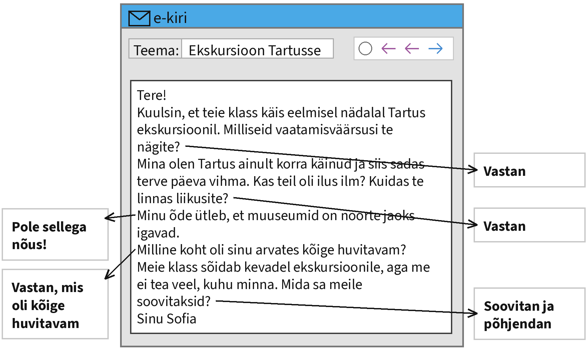

Kirjuta oma kiri siia:

[[___ ___ ___ ___ ___ ___ ___ ___ ___ ___ ___ ___]]

> **Kontrolli enne, kui vajutad „Saada”:** kas vastasid kõigile noolega näidatud märkmetele? Kas kirjas on pöördumine ja lõpetus? Kas tekstis on umbes 100 sõna?

> **NB!** Sinu tekst salvestub ainult sinu enda brauserisse. Õpetaja seda siit ei näe. Kopeeri valmis tekst ja esita see nii, nagu õpetaja ütleb.

#### 2. ülesanne: kokkuvõte diagrammi põhjal

**Loe ülesannet ja kirjuta kokkuvõte allolevasse kasti.**

Kujuta ette, et teie kooli õpilasesindus korraldas 2026. aasta oktoobris küsitluse, milles osales 210 õpilast 7.–9. klassist. Näed allpool küsitluse tulemusi diagrammil. Kirjuta nende tulemuste põhjal tekst, milles

- tee vastustest kokkuvõte;
- analüüsi, miks on muuseumid ja teaduskeskused noorte seas nii populaarsed;
- kirjuta, millist Eesti vaatamisväärsust sina soovitaksid ja miks;
- arutle, kuidas teha klassiekskursioon huvitavaks kõigile õpilastele.

**Teksti nõutav pikkus on u 160 sõna.**

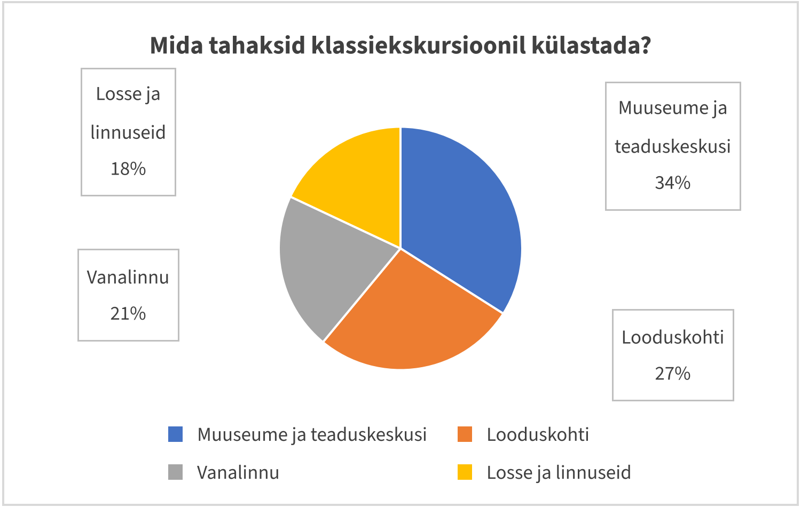

Kirjuta oma kokkuvõte siia:

[[___ ___ ___ ___ ___ ___ ___ ___ ___ ___ ___ ___ ___ ___ ___ ___]]

> **Kontrolli enne, kui vajutad „Saada”:** kas kirjutasid kõigist neljast punktist? Kas kasutasid diagrammi arve? Kas tekstis on umbes 160 sõna?

> **NB!** Sinu tekst salvestub ainult sinu enda brauserisse. Õpetaja seda siit ei näe. Kopeeri valmis tekst ja esita see nii, nagu õpetaja ütleb.

### Lugemine

Lugemisosas on neli ülesannet. Iga ülesanne on eraldi lehel.

#### 2.1 Vestlus

**Täienda Sofia ja Kevini vestlust. Kaks vastust jääb üle. Esimene vastus on näidis ja see lünk on juba täidetud.**

_Vali iga vastuse jaoks rippmenüüst sobiv lause ja vajuta „Kontrolli”._

**Sofia:** Tere, Kevin! Mu nõbu tuleb laupäeval Lätist külla. Kas sa aitaksid mul talle Tallinna näidata?

**Kevin:** _Tere! Muidugi aitan. Aga mis teda kõige rohkem huvitab?_ (näidis)

**Sofia:** Ta armastab ajalugu. Kust me võiksime alustada?

**Kevin:** 1. [[ Ma käisin eile kinos ja film oli väga igav. | Jah, Lennusadam on väga huvitav. Seal saab minna vana allveelaeva sisse. | (Kõige parem on alustada vanalinnast. Seal on Raekoja plats ja vanad linnamüürid.) | Ei, ma ei ole Lätis kunagi käinud. | Siis jääme kauemaks muuseumi. Seal on terveks päevaks tegevust. | Umbes kaks tundi. Ostame piletid internetist, siis pole vaja järjekorras seista. | Telliskivi loomelinnakus on palju kohvikuid. Sinna ei ole Lennusadamast pikk maa. ]]

**Sofia:** Kas me peaksime ka mõnda muuseumi minema?

**Kevin:** 2. [[ Ma käisin eile kinos ja film oli väga igav. | (Jah, Lennusadam on väga huvitav. Seal saab minna vana allveelaeva sisse.) | Kõige parem on alustada vanalinnast. Seal on Raekoja plats ja vanad linnamüürid. | Ei, ma ei ole Lätis kunagi käinud. | Siis jääme kauemaks muuseumi. Seal on terveks päevaks tegevust. | Umbes kaks tundi. Ostame piletid internetist, siis pole vaja järjekorras seista. | Telliskivi loomelinnakus on palju kohvikuid. Sinna ei ole Lennusadamast pikk maa. ]]

**Sofia:** Kui kaua seal aega kulub?

**Kevin:** 3. [[ Ma käisin eile kinos ja film oli väga igav. | Jah, Lennusadam on väga huvitav. Seal saab minna vana allveelaeva sisse. | Kõige parem on alustada vanalinnast. Seal on Raekoja plats ja vanad linnamüürid. | Ei, ma ei ole Lätis kunagi käinud. | Siis jääme kauemaks muuseumi. Seal on terveks päevaks tegevust. | (Umbes kaks tundi. Ostame piletid internetist, siis pole vaja järjekorras seista.) | Telliskivi loomelinnakus on palju kohvikuid. Sinna ei ole Lennusadamast pikk maa. ]]

**Sofia:** Ja kus me lõunat sööme?

**Kevin:** 4. [[ Ma käisin eile kinos ja film oli väga igav. | Jah, Lennusadam on väga huvitav. Seal saab minna vana allveelaeva sisse. | Kõige parem on alustada vanalinnast. Seal on Raekoja plats ja vanad linnamüürid. | Ei, ma ei ole Lätis kunagi käinud. | Siis jääme kauemaks muuseumi. Seal on terveks päevaks tegevust. | Umbes kaks tundi. Ostame piletid internetist, siis pole vaja järjekorras seista. | (Telliskivi loomelinnakus on palju kohvikuid. Sinna ei ole Lennusadamast pikk maa.) ]]

**Sofia:** Mis siis, kui sajab vihma?

**Kevin:** 5. [[ Ma käisin eile kinos ja film oli väga igav. | Jah, Lennusadam on väga huvitav. Seal saab minna vana allveelaeva sisse. | Kõige parem on alustada vanalinnast. Seal on Raekoja plats ja vanad linnamüürid. | Ei, ma ei ole Lätis kunagi käinud. | (Siis jääme kauemaks muuseumi. Seal on terveks päevaks tegevust.) | Umbes kaks tundi. Ostame piletid internetist, siis pole vaja järjekorras seista. | Telliskivi loomelinnakus on palju kohvikuid. Sinna ei ole Lennusadamast pikk maa. ]]

**Sofia:** Suurepärane! Kohtume siis laupäeval kell kümme Vabaduse väljakul.

#### 2.3 Valikvastused

**Loe teksti ja selle kõrval olevaid küsimusi. Otsusta, milline vastus on õige. Igale küsimusele on üks sobiv vastus. Kõigepealt on näidis ja see on juba ära märgitud.**

_Vali iga küsimuse juures õige vastus ja vajuta „Kontrolli”._

**Teletorn – Tallinna kõrgeim vaatamisväärsus**

Tallinna teletorn on Eesti kõrgeim ehitis. Torn on 314 meetrit kõrge ja seda on näha juba kaugelt merelt. Teletorn valmis 1980. aastal, kui Tallinnas toimus Moskva olümpiamängude purjeregatt.

Algselt oli torni ülesanne edastada raadio- ja telesignaali. Sellega tegeleb torn ka praegu, kuid tänapäeval on see eelkõige populaarne turismiobjekt, mida külastavad nii eestlased kui ka välismaalased.

Teletornil on oluline koht ka Eesti ajaloos. 1991. aasta augustis, kui Eesti taastas iseseisvuse, püüdsid Nõukogude sõdurid torni vallutada. Tornis olnud raadiomehed lukustasid end aga sisse ja sõdurid pidid lõpuks lahkuma.

Pärast põhjalikku remonti avati torn külastajatele uuesti 2012. aastal. Kiire lift viib külastajad vähem kui minutiga 22. korrusele, kus asub vaateplatvorm. Selge ilmaga paistab sealt kogu Tallinn ja isegi Soome rannik.

Julgematele külastajatele pakutakse võimalust kõndida torni välisäärel. Sel ajal on inimene turvavööga kinnitatud ja kõrval on alati instruktor. Paljud ütlevad, et see on nende elu kõige põnevam kogemus.

Teletorn asub Pirita linnaosas, botaanikaaia lähedal. Sinna saab kesklinnast bussiga umbes poole tunniga. Pärast torni külastust tasub jalutada metsas või minna Pirita randa.

**0. Kui kõrge on Tallinna teletorn?** (näidis)

- Üle 400 meetri.
- **314 meetrit.** ✓
- 22 meetrit.

**1. Mille jaoks teletorn algselt ehitati?**

[( )] Turistide jaoks.
[( )] Sõjaväe jaoks.
[(X)] Raadio- ja telesignaali edastamiseks.

**2. Mis juhtus tornis 1991. aasta augustis?**

[( )] Tornis toimus kontsert.
[(X)] Raadiomehed ei lasknud sõdureid torni.
[( )] Torn suleti remondiks.

**3. Mis juhtus 2012. aastal?**

[(X)] Torn avati pärast remonti uuesti.
[( )] Torni ehitati 22. korrus.
[( )] Torn suleti külastajatele.

**4. Kui kiiresti sõidab lift vaateplatvormile?**

[( )] Poole tunniga.
[(X)] Vähem kui minutiga.
[( )] Umbes viie minutiga.

**5. Mida peab tegema torni välisäärel kõndija?**

[( )] Olema üle kahekümne aasta vana.
[(X)] Kandma turvavööd.
[( )] Maksma topelthinda.

**6. Millal on vaateplatvormilt näha Soome rannik?**

[(X)] Selge ilmaga.
[( )] Ainult öösel.
[( )] Ainult talvel.

**7. Mida soovitab tekst pärast torni külastust teha?**

[( )] Sõita bussiga kesklinna.
[( )] Külastada olümpiamuuseumi.
[(X)] Jalutada metsas või minna randa.

#### 2.4 Lünktekst

**Loe katkendit Mia ekskursioonimuljetest ja täida tekstis lüngad. Näidis on sobiva vastusevariandiga juba täidetud. Üks vastusevariant jääb üle.**

_Vali iga lünga jaoks rippmenüüst sobiv jätk ja vajuta „Kontrolli”._

**Ekskursioon Lahemaale**

Eelmisel nädalal käisime klassiga Lahemaa rahvuspargis, **mis on Eesti kõige vanem rahvuspark**. Bussis rääkis giid, (1) [[ milles kalurid kunagi oma võrke hoidsid | et seal ka telgis ööbida | sest muuseum oli esmaspäeval suletud | et me ei suutnud neid kokku lugeda | kus pakuti traditsioonilist eesti toitu | (et Lahemaa nimi tähendab lahtede maad) | mida kutsutakse ka kaptenite külaks | mille keskel särasid väikesed järved | kes ujusid rahulikult tiigis | kuid kõndida oli lihtne ja mõnus | et tundsin end nagu muinasjutus ]]. Ma ei teadnud varem, et Lahemaa rahvuspark loodi juba 1971. aastal.

Esimesena külastasime Palmse mõisa. Mõisa peahoone oli nii uhke, (2) [[ milles kalurid kunagi oma võrke hoidsid | et seal ka telgis ööbida | sest muuseum oli esmaspäeval suletud | et me ei suutnud neid kokku lugeda | kus pakuti traditsioonilist eesti toitu | et Lahemaa nimi tähendab lahtede maad | mida kutsutakse ka kaptenite külaks | mille keskel särasid väikesed järved | kes ujusid rahulikult tiigis | kuid kõndida oli lihtne ja mõnus | (et tundsin end nagu muinasjutus) ]]. Mõisapargis jalutades nägime luiki, (3) [[ milles kalurid kunagi oma võrke hoidsid | et seal ka telgis ööbida | sest muuseum oli esmaspäeval suletud | et me ei suutnud neid kokku lugeda | kus pakuti traditsioonilist eesti toitu | et Lahemaa nimi tähendab lahtede maad | mida kutsutakse ka kaptenite külaks | mille keskel särasid väikesed järved | (kes ujusid rahulikult tiigis) | kuid kõndida oli lihtne ja mõnus | et tundsin end nagu muinasjutus ]].

Seejärel sõitsime Viru rappa. Laudtee oli pikk, (4) [[ milles kalurid kunagi oma võrke hoidsid | et seal ka telgis ööbida | sest muuseum oli esmaspäeval suletud | et me ei suutnud neid kokku lugeda | kus pakuti traditsioonilist eesti toitu | et Lahemaa nimi tähendab lahtede maad | mida kutsutakse ka kaptenite külaks | mille keskel särasid väikesed järved | kes ujusid rahulikult tiigis | (kuid kõndida oli lihtne ja mõnus) | et tundsin end nagu muinasjutus ]]. Vaatetornist paistis lõputu raba, (5) [[ milles kalurid kunagi oma võrke hoidsid | et seal ka telgis ööbida | sest muuseum oli esmaspäeval suletud | et me ei suutnud neid kokku lugeda | kus pakuti traditsioonilist eesti toitu | et Lahemaa nimi tähendab lahtede maad | mida kutsutakse ka kaptenite külaks | (mille keskel särasid väikesed järved) | kes ujusid rahulikult tiigis | kuid kõndida oli lihtne ja mõnus | et tundsin end nagu muinasjutus ]].

Lõunat sõime Altja kõrtsis, (6) [[ milles kalurid kunagi oma võrke hoidsid | et seal ka telgis ööbida | sest muuseum oli esmaspäeval suletud | et me ei suutnud neid kokku lugeda | (kus pakuti traditsioonilist eesti toitu) | et Lahemaa nimi tähendab lahtede maad | mida kutsutakse ka kaptenite külaks | mille keskel särasid väikesed järved | kes ujusid rahulikult tiigis | kuid kõndida oli lihtne ja mõnus | et tundsin end nagu muinasjutus ]]. Pärast sööki näitas giid meile vanu kalurionne, (7) [[ (milles kalurid kunagi oma võrke hoidsid) | et seal ka telgis ööbida | sest muuseum oli esmaspäeval suletud | et me ei suutnud neid kokku lugeda | kus pakuti traditsioonilist eesti toitu | et Lahemaa nimi tähendab lahtede maad | mida kutsutakse ka kaptenite külaks | mille keskel särasid väikesed järved | kes ujusid rahulikult tiigis | kuid kõndida oli lihtne ja mõnus | et tundsin end nagu muinasjutus ]].

Viimasena käisime Käsmu külas, (8) [[ milles kalurid kunagi oma võrke hoidsid | et seal ka telgis ööbida | sest muuseum oli esmaspäeval suletud | et me ei suutnud neid kokku lugeda | kus pakuti traditsioonilist eesti toitu | et Lahemaa nimi tähendab lahtede maad | (mida kutsutakse ka kaptenite külaks) | mille keskel särasid väikesed järved | kes ujusid rahulikult tiigis | kuid kõndida oli lihtne ja mõnus | et tundsin end nagu muinasjutus ]]. Rannas oli nii palju suuri kive, (9) [[ milles kalurid kunagi oma võrke hoidsid | et seal ka telgis ööbida | sest muuseum oli esmaspäeval suletud | (et me ei suutnud neid kokku lugeda) | kus pakuti traditsioonilist eesti toitu | et Lahemaa nimi tähendab lahtede maad | mida kutsutakse ka kaptenite külaks | mille keskel särasid väikesed järved | kes ujusid rahulikult tiigis | kuid kõndida oli lihtne ja mõnus | et tundsin end nagu muinasjutus ]]. Koju jõudsime alles õhtul. Olin väsinud, aga õnnelik ja tahan kindlasti Lahemaale tagasi minna, (10) [[ milles kalurid kunagi oma võrke hoidsid | (et seal ka telgis ööbida) | sest muuseum oli esmaspäeval suletud | et me ei suutnud neid kokku lugeda | kus pakuti traditsioonilist eesti toitu | et Lahemaa nimi tähendab lahtede maad | mida kutsutakse ka kaptenite külaks | mille keskel särasid väikesed järved | kes ujusid rahulikult tiigis | kuid kõndida oli lihtne ja mõnus | et tundsin end nagu muinasjutus ]].

#### 2.5 Lausete lõpud

**Lõpeta laused. Üks lause lõpp jääb üle. Esimene lause on näidis ja see on juba ära märgitud.**

_Vali iga lünga jaoks rippmenüüst sobiv jätk ja vajuta „Kontrolli”._

**Suvi Saaremaal**

Suvel käisime perega Saaremaal, **sest isa tahtis näidata meile oma lapsepõlve kodu.** Virtsust sõitsime praamiga Muhu saarele, (1) [[ seepärast ei julgenud ma päris ääre juurde minna. | mille vesi tundus peaaegu must. | mis on üks paremini säilinud keskaegseid linnuseid Eestis. | mille kalurid olid samal hommikul merest püüdnud. | otsustasin, et tulen järgmisel suvel tagasi. | mis on Saaremaa kõrgeim pank. | kuid buss oli juba ära läinud. | aga trepp üles oli väga kitsas ja järsk. | mis tekkis tuhandeid aastaid tagasi meteoriidi kukkumisel. | (kust viib tamm otse Saaremaale.) | nii et pidime kogu aeg mütsist kinni hoidma. ]] Praami peal oli tugev tuul, (2) [[ seepärast ei julgenud ma päris ääre juurde minna. | mille vesi tundus peaaegu must. | mis on üks paremini säilinud keskaegseid linnuseid Eestis. | mille kalurid olid samal hommikul merest püüdnud. | otsustasin, et tulen järgmisel suvel tagasi. | mis on Saaremaa kõrgeim pank. | kuid buss oli juba ära läinud. | aga trepp üles oli väga kitsas ja järsk. | mis tekkis tuhandeid aastaid tagasi meteoriidi kukkumisel. | kust viib tamm otse Saaremaale. | (nii et pidime kogu aeg mütsist kinni hoidma.) ]] Kuressaares külastasime piiskopilinnust, (3) [[ seepärast ei julgenud ma päris ääre juurde minna. | mille vesi tundus peaaegu must. | (mis on üks paremini säilinud keskaegseid linnuseid Eestis.) | mille kalurid olid samal hommikul merest püüdnud. | otsustasin, et tulen järgmisel suvel tagasi. | mis on Saaremaa kõrgeim pank. | kuid buss oli juba ära läinud. | aga trepp üles oli väga kitsas ja järsk. | mis tekkis tuhandeid aastaid tagasi meteoriidi kukkumisel. | kust viib tamm otse Saaremaale. | nii et pidime kogu aeg mütsist kinni hoidma. ]] Linnuse tornist avanes vaade merele, (4) [[ seepärast ei julgenud ma päris ääre juurde minna. | mille vesi tundus peaaegu must. | mis on üks paremini säilinud keskaegseid linnuseid Eestis. | mille kalurid olid samal hommikul merest püüdnud. | otsustasin, et tulen järgmisel suvel tagasi. | mis on Saaremaa kõrgeim pank. | kuid buss oli juba ära läinud. | (aga trepp üles oli väga kitsas ja järsk.) | mis tekkis tuhandeid aastaid tagasi meteoriidi kukkumisel. | kust viib tamm otse Saaremaale. | nii et pidime kogu aeg mütsist kinni hoidma. ]] Järgmisel päeval sõitsime Kaali kraatri juurde, (5) [[ seepärast ei julgenud ma päris ääre juurde minna. | mille vesi tundus peaaegu must. | mis on üks paremini säilinud keskaegseid linnuseid Eestis. | mille kalurid olid samal hommikul merest püüdnud. | otsustasin, et tulen järgmisel suvel tagasi. | mis on Saaremaa kõrgeim pank. | kuid buss oli juba ära läinud. | aga trepp üles oli väga kitsas ja järsk. | (mis tekkis tuhandeid aastaid tagasi meteoriidi kukkumisel.) | kust viib tamm otse Saaremaale. | nii et pidime kogu aeg mütsist kinni hoidma. ]] Kraatri põhjas oli väike järv, (6) [[ seepärast ei julgenud ma päris ääre juurde minna. | (mille vesi tundus peaaegu must.) | mis on üks paremini säilinud keskaegseid linnuseid Eestis. | mille kalurid olid samal hommikul merest püüdnud. | otsustasin, et tulen järgmisel suvel tagasi. | mis on Saaremaa kõrgeim pank. | kuid buss oli juba ära läinud. | aga trepp üles oli väga kitsas ja järsk. | mis tekkis tuhandeid aastaid tagasi meteoriidi kukkumisel. | kust viib tamm otse Saaremaale. | nii et pidime kogu aeg mütsist kinni hoidma. ]] Pärast seda läksime Panga panka vaatama, (7) [[ seepärast ei julgenud ma päris ääre juurde minna. | mille vesi tundus peaaegu must. | mis on üks paremini säilinud keskaegseid linnuseid Eestis. | mille kalurid olid samal hommikul merest püüdnud. | otsustasin, et tulen järgmisel suvel tagasi. | (mis on Saaremaa kõrgeim pank.) | kuid buss oli juba ära läinud. | aga trepp üles oli väga kitsas ja järsk. | mis tekkis tuhandeid aastaid tagasi meteoriidi kukkumisel. | kust viib tamm otse Saaremaale. | nii et pidime kogu aeg mütsist kinni hoidma. ]] Pangal oli väga tuuline, (8) [[ (seepärast ei julgenud ma päris ääre juurde minna.) | mille vesi tundus peaaegu must. | mis on üks paremini säilinud keskaegseid linnuseid Eestis. | mille kalurid olid samal hommikul merest püüdnud. | otsustasin, et tulen järgmisel suvel tagasi. | mis on Saaremaa kõrgeim pank. | kuid buss oli juba ära läinud. | aga trepp üles oli väga kitsas ja järsk. | mis tekkis tuhandeid aastaid tagasi meteoriidi kukkumisel. | kust viib tamm otse Saaremaale. | nii et pidime kogu aeg mütsist kinni hoidma. ]] Õhtul sõime Kuressaares kala, (9) [[ seepärast ei julgenud ma päris ääre juurde minna. | mille vesi tundus peaaegu must. | mis on üks paremini säilinud keskaegseid linnuseid Eestis. | (mille kalurid olid samal hommikul merest püüdnud.) | otsustasin, et tulen järgmisel suvel tagasi. | mis on Saaremaa kõrgeim pank. | kuid buss oli juba ära läinud. | aga trepp üles oli väga kitsas ja järsk. | mis tekkis tuhandeid aastaid tagasi meteoriidi kukkumisel. | kust viib tamm otse Saaremaale. | nii et pidime kogu aeg mütsist kinni hoidma. ]] Kui reis läbi sai, (10) [[ seepärast ei julgenud ma päris ääre juurde minna. | mille vesi tundus peaaegu must. | mis on üks paremini säilinud keskaegseid linnuseid Eestis. | mille kalurid olid samal hommikul merest püüdnud. | (otsustasin, et tulen järgmisel suvel tagasi.) | mis on Saaremaa kõrgeim pank. | kuid buss oli juba ära läinud. | aga trepp üles oli väga kitsas ja järsk. | mis tekkis tuhandeid aastaid tagasi meteoriidi kukkumisel. | kust viib tamm otse Saaremaale. | nii et pidime kogu aeg mütsist kinni hoidma. ]]

### Keelestruktuur

Keelestruktuuri osas on kaks ülesannet. Iga ülesanne on eraldi lehel.

#### 2.6 Vali sobiv sõna

**Loe teksti ja vali lünka sobiv sõna. Esimene lünk on näidis ja seal on õige vastus ära valitud.**

_Vali iga lünga jaoks rippmenüüst sobiv sõna ja vajuta „Kontrolli”._

**Tartu – ülikoolilinn**

Tartu on suuruselt Eesti **teine** linn. Seda nimetatakse ülikoolilinnaks, sest Tartu ülikool asutati juba 1632. [[ aasta | (aastal) | aastat ]].

Linnas elab palju [[ üliõpilastel | üliõpilased | (üliõpilasi) ]], kes tulevad Tartusse õppima nii Eesti eri [[ paigad | paikades | (paikadest) ]] kui ka välismaalt.

Tartu tuntuim vaatamisväärsus on Raekoja plats, kus seisab suudlevate [[ tudengid | (tudengite) | tudengeid ]] skulptuur. Platsi ääres on palju [[ kohvikutes | kohvikud | (kohvikuid) ]], kus noored armastavad aega veeta. Toomemäel kasvavad vanad puud ja seal asuvad toomkiriku [[ varemetel | (varemed) | varemeid ]].

Laste ja [[ noored | noori | (noorte) ]] seas on väga populaarne AHHAA teaduskeskus. Seal saab ise teha [[ (katseid) | katsetes | katsed ]] ja vaadata planetaariumis tähistaevast.

Kevadel toimuvad Tartus tudengipäevad, mil linn on täis [[ rõõmsate | (rõõmsaid) | rõõmsad ]] inimesi. Kes Tartut veel külastanud ei ole, peaks seda kindlasti [[ tegemist | (tegema) | teeb ]].

#### 2.7 Sõna õige vorm

**Loe teksti ja kirjuta lünka sõna õige vorm. Igas lüngas on antud sõna algvorm, pane see sellisesse vormi, mis sobib teksti. Esimene lünk on näidis: sulgudes on sõna algvorm ja selle kõrval lünka sobiv vorm.**

_Kirjuta sulgudes oleva sõna õige vorm lünka ja vajuta „Kontrolli”._

**Ekskursioon Narva**

Meie klass käis eelmisel nädalal ekskursioonil Narvas. Narva asub Eesti kõige _(idapoolne)_ **idapoolsemas** osas. Kõigepealt külastasime Narva _(linnus)_ [[linnust]]. Linnuse tornist nägime teisel pool jõge Ivangorodi linnust, mis kuulub _(Venemaa)_ [[Venemaale]]. Giid rääkis, et Narva linnus on ehitatud juba 13. _(sajand)_ [[sajandil]].

Linnuses on muuseum, kus nägime vanu _(relv)_ [[relvi]] ja _(rõivas)_ [[rõivaid]]. Pärast seda jalutasime mööda _(jõgi)_ [[jõe]] kallast. Jõe ääres oli palju _(kalur)_ [[kalureid]]. Lõunat sõime _(kohvik)_ [[kohvikus]], kust avanes vaade linnusele.

Õhtul sõitsime rongiga tagasi _(Tallinn)_ [[Tallinnasse]]. Kõigi _(õpilane)_ [[õpilaste]] arvates oli see aasta parim ekskursioon.

## Kliimavöötmed

**Töölehed PDF-ina (printimiseks):** [Kirjutamine](kliimavootmed_kirjutamine.pdf) · [Lugemine](kliimavootmed_lugemine.pdf) · [Keelestruktuur](kliimavootmed_keelestruktuur.pdf) · [Kõik koos](kliimavootmed_koik_toolehed.pdf)

### Kirjutamine

#### 1. ülesanne: kiri

**Loe ülesannet ja kirjuta oma vastus allolevasse kasti.**

Kujuta ette, et sul on sõber Lucas, kes elab Hispaanias. Ta tahab teada, milline on Eesti kliima. Loe tema kirja ja vasta sellele noolega näidatud märkmete järgi. Kasuta kõiki märkmeid. **Teksti pikkus peab olema u 100 sõna.**

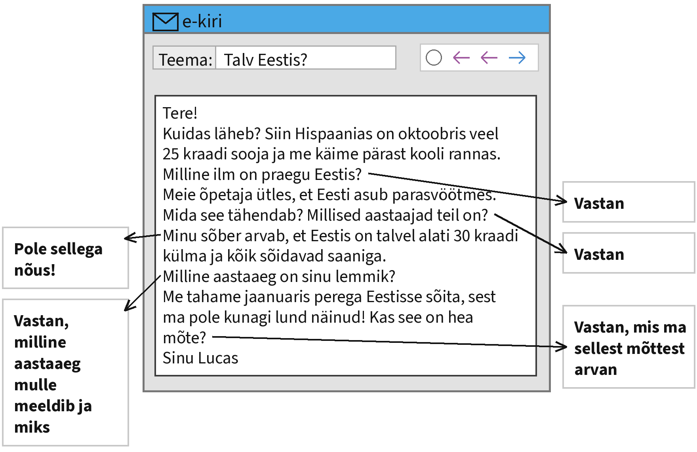

Kirjuta oma kiri siia:

[[___ ___ ___ ___ ___ ___ ___ ___ ___ ___ ___ ___]]

> **Kontrolli enne, kui vajutad „Saada”:** kas vastasid kõigile noolega näidatud märkmetele? Kas kirjas on pöördumine ja lõpetus? Kas tekstis on umbes 100 sõna?

> **NB!** Sinu tekst salvestub ainult sinu enda brauserisse. Õpetaja seda siit ei näe. Kopeeri valmis tekst ja esita see nii, nagu õpetaja ütleb.

#### 2. ülesanne: kokkuvõte diagrammi põhjal

**Loe ülesannet ja kirjuta kokkuvõte allolevasse kasti.**

Kujuta ette, et teie kooli õpilasesindus korraldas 2026. aasta novembris küsitluse, milles osales 200 õpilast 7.–9. klassist. Näed allpool küsitluse tulemusi diagrammil. Kirjuta nende tulemuste põhjal tekst, milles

- tee vastustest kokkuvõte;
- analüüsi, miks teevad tormid ja kuumalained noortele kõige rohkem muret;
- kirjuta, kuidas on kliima muutumine mõjutanud sinu kodukohta või sinu elu;
- arutle, mida saavad noored teha, et kliima muutumist aeglustada.

**Teksti nõutav pikkus on u 160 sõna.**

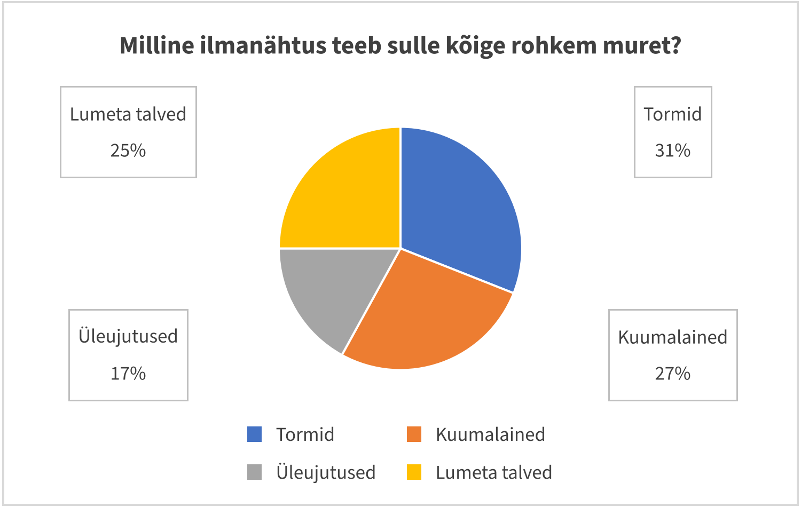

Kirjuta oma kokkuvõte siia:

[[___ ___ ___ ___ ___ ___ ___ ___ ___ ___ ___ ___ ___ ___ ___ ___]]

> **Kontrolli enne, kui vajutad „Saada”:** kas kirjutasid kõigist neljast punktist? Kas kasutasid diagrammi arve? Kas tekstis on umbes 160 sõna?

> **NB!** Sinu tekst salvestub ainult sinu enda brauserisse. Õpetaja seda siit ei näe. Kopeeri valmis tekst ja esita see nii, nagu õpetaja ütleb.

### Lugemine

Lugemisosas on neli ülesannet. Iga ülesanne on eraldi lehel.

#### 2.1 Vestlus

**Täienda Laura ja Danieli vestlust. Kaks vastust jääb üle. Esimene vastus on näidis ja see lünk on juba täidetud.**

_Vali iga vastuse jaoks rippmenüüst sobiv lause ja vajuta „Kontrolli”._

**Laura:** Tere, Daniel! Kuulsin, et lähed jõulude ajal perega reisile. Kuhu te sõidate?

**Daniel:** _Tere! Me lendame Egiptusesse. Seal on talvel ka umbes kakskümmend viis kraadi sooja._ (näidis)

**Laura:** Kakskümmend viis kraadi detsembris? Mis kliimavöötmes Egiptus asub?

**Daniel:** 1. [[ Jah, see on minu suurim unistus. Olen neid seni ainult raamatutes näinud. | (Põhja-Egiptus asub lähistroopikas. Talv on seal soe ja kuiv.) | Me sõidame autoga Lätti ja sealt edasi Leetu. | Ära kurvasta! Ma toon sulle Egiptusest ühe ilusa suveniiri. | Väga harva. Suurem osa riigist on kõrb ja mõnes kohas ei saja aastaid. | Jõuluvana elab Lapimaal, kus on talvel väga külm. | Kindlasti päikesekreemi, mütsi ja päikeseprillid. Päike on seal palju tugevam kui Eestis. ]]

**Laura:** Kas seal üldse vihma sajab?

**Daniel:** 2. [[ Jah, see on minu suurim unistus. Olen neid seni ainult raamatutes näinud. | Põhja-Egiptus asub lähistroopikas. Talv on seal soe ja kuiv. | Me sõidame autoga Lätti ja sealt edasi Leetu. | Ära kurvasta! Ma toon sulle Egiptusest ühe ilusa suveniiri. | (Väga harva. Suurem osa riigist on kõrb ja mõnes kohas ei saja aastaid.) | Jõuluvana elab Lapimaal, kus on talvel väga külm. | Kindlasti päikesekreemi, mütsi ja päikeseprillid. Päike on seal palju tugevam kui Eestis. ]]

**Laura:** Mida sa sinna kaasa võtad?

**Daniel:** 3. [[ Jah, see on minu suurim unistus. Olen neid seni ainult raamatutes näinud. | Põhja-Egiptus asub lähistroopikas. Talv on seal soe ja kuiv. | Me sõidame autoga Lätti ja sealt edasi Leetu. | Ära kurvasta! Ma toon sulle Egiptusest ühe ilusa suveniiri. | Väga harva. Suurem osa riigist on kõrb ja mõnes kohas ei saja aastaid. | Jõuluvana elab Lapimaal, kus on talvel väga külm. | (Kindlasti päikesekreemi, mütsi ja päikeseprillid. Päike on seal palju tugevam kui Eestis.) ]]

**Laura:** Kas te lähete ka püramiide vaatama?

**Daniel:** 4. [[ (Jah, see on minu suurim unistus. Olen neid seni ainult raamatutes näinud.) | Põhja-Egiptus asub lähistroopikas. Talv on seal soe ja kuiv. | Me sõidame autoga Lätti ja sealt edasi Leetu. | Ära kurvasta! Ma toon sulle Egiptusest ühe ilusa suveniiri. | Väga harva. Suurem osa riigist on kõrb ja mõnes kohas ei saja aastaid. | Jõuluvana elab Lapimaal, kus on talvel väga külm. | Kindlasti päikesekreemi, mütsi ja päikeseprillid. Päike on seal palju tugevam kui Eestis. ]]

**Laura:** Mul on natuke kade meel. Siin on jõulude ajal ainult pime ja lörtsine.

**Daniel:** 5. [[ Jah, see on minu suurim unistus. Olen neid seni ainult raamatutes näinud. | Põhja-Egiptus asub lähistroopikas. Talv on seal soe ja kuiv. | Me sõidame autoga Lätti ja sealt edasi Leetu. | (Ära kurvasta! Ma toon sulle Egiptusest ühe ilusa suveniiri.) | Väga harva. Suurem osa riigist on kõrb ja mõnes kohas ei saja aastaid. | Jõuluvana elab Lapimaal, kus on talvel väga külm. | Kindlasti päikesekreemi, mütsi ja päikeseprillid. Päike on seal palju tugevam kui Eestis. ]]

**Laura:** Aitäh! Head reisi ja saada mulle palju pilte!

#### 2.3 Valikvastused

**Loe teksti ja selle kõrval olevaid küsimusi. Otsusta, milline vastus on õige. Igale küsimusele on üks sobiv vastus. Kõigepealt on näidis ja see on juba ära märgitud.**

_Vali iga küsimuse juures õige vastus ja vajuta „Kontrolli”._

**Maailma kliimavöötmed**

Maakera kliima ei ole igal pool ühesugune. Kliima sõltub eelkõige sellest, kui palju päikesesoojust mingi koht saab. Kõige rohkem soojust saavad ekvaatori lähedal asuvad alad, kõige vähem aga poolused. Seetõttu jagatakse maakera kliimavöötmeteks.

Ekvaatori ümbruses on ekvatoriaalne kliimavööde. Seal on aasta läbi palav ja niiske ning vihma sajab peaaegu iga päev. Aastaaegu selles vöötmes ei ole. Sellise kliimaga piirkondades kasvavad tihedad vihmametsad.

Ekvatoriaalse vöötme mõlemal pool asub troopiline kliimavööde. Seal on samuti palav, kuid sademeid on vähem. Troopikas asuvad maailma suurimad kõrbed, näiteks Sahara. Kõrbes võib päeval olla üle 40 kraadi sooja, öösel aga langeb temperatuur järsult.

Lähistroopilises kliimavöötmes on suvi kuum ja kuiv, talv aga pehme ja vihmane. Sellist kliimat nimetatakse ka vahemereliseks, sest see on iseloomulik Vahemere maadele, näiteks Itaaliale ja Kreekale.

Parasvöötmes on neli selgelt eristuvat aastaaega. Ka Eesti asub parasvöötmes. Meie kliimat mõjutab tugevalt meri, mistõttu on talved pehmemad ja suved jahedamad kui sama laiuskraadi sisemaa aladel.

Polaarvöötmes on aasta läbi külm. Talvel ei tõuse päike seal mitu nädalat üldse horisondi kohale, suvel aga ei lähe see öösiti looja. Seda nimetatakse polaaröö ja polaarpäevaks.

**0. Millest sõltub kliima eelkõige?** (näidis)

- Mere sügavusest.
- **Päikesesoojuse hulgast.** ✓
- Mägede kõrgusest.

**1. Milline on ilm ekvatoriaalses kliimavöötmes?**

[( )] Külm ja kuiv.
[(X)] Palav ja niiske kogu aasta.
[( )] Kuum suvi ja külm talv.

**2. Kus asub Sahara kõrb?**

[(X)] Troopilises kliimavöötmes.
[( )] Ekvatoriaalses kliimavöötmes.
[( )] Polaarvöötmes.

**3. Mis iseloomustab kõrbe ilma?**

[( )] Talvel sajab palju lund.
[(X)] Öösel läheb järsult jahedaks.
[( )] Iga päev sajab vihma.

**4. Miks nimetatakse lähistroopilist kliimat ka vahemereliseks?**

[( )] Sest seal on palju meresid.
[(X)] Sest see on iseloomulik Vahemere maadele.
[( )] Sest seal on vahel külm.

**5. Milline on Eesti kliima võrreldes sisemaaga?**

[(X)] Talv on pehmem ja suvi jahedam.
[( )] Talv on külmem ja suvi soojem.
[( )] Vahet ei ole.

**6. Mis on polaarpäev?**

[( )] Päike ei tõuse üldse.
[( )] Päev on väga lühike.
[(X)] Päike ei lähe öösel looja.

**7. Kus kasvavad tihedad vihmametsad?**

[( )] Polaarvöötmes.
[(X)] Ekvatoriaalses kliimavöötmes.
[( )] Parasvöötmes.

#### 2.4 Lünktekst

**Loe katkendit Mari blogist ja täida tekstis lüngad. Näidis on sobiva vastusevariandiga juba täidetud. Üks vastusevariant jääb üle.**

_Vali iga lünga jaoks rippmenüüst sobiv jätk ja vajuta „Kontrolli”._

**Minu aasta Hispaanias**

Eelmisel õppeaastal elasin perega Hispaanias, **sest isa sai seal ajutise töökoha**. Me elasime Valencia linnas, (1) [[ (mis asub Vahemere ääres) | kus kasvavad tihedad vihmametsad | et pärast kooli läksime kohe randa ujuma | kuidas saab külma ilma järele igatseda | sest inimesed puhkasid kodus varjus | kus kõik oli valge ja külm | nii et päeval oli raske õues olla | sest minu jaoks oli see pigem kevadilm | nagu oleks väljas tõeline pakane | kuid klassiruumides töötas kogu aeg konditsioneer | et armastan tegelikult kõiki nelja aastaaega ]]. Kliima oli seal hoopis teistsugune kui Eestis.

Septembris oli veel nii palav, (2) [[ mis asub Vahemere ääres | kus kasvavad tihedad vihmametsad | (et pärast kooli läksime kohe randa ujuma) | kuidas saab külma ilma järele igatseda | sest inimesed puhkasid kodus varjus | kus kõik oli valge ja külm | nii et päeval oli raske õues olla | sest minu jaoks oli see pigem kevadilm | nagu oleks väljas tõeline pakane | kuid klassiruumides töötas kogu aeg konditsioneer | et armastan tegelikult kõiki nelja aastaaega ]]. Koolis käisime lühikestes pükstes ja T-särgis, (3) [[ mis asub Vahemere ääres | kus kasvavad tihedad vihmametsad | et pärast kooli läksime kohe randa ujuma | kuidas saab külma ilma järele igatseda | sest inimesed puhkasid kodus varjus | kus kõik oli valge ja külm | nii et päeval oli raske õues olla | sest minu jaoks oli see pigem kevadilm | nagu oleks väljas tõeline pakane | (kuid klassiruumides töötas kogu aeg konditsioneer) | et armastan tegelikult kõiki nelja aastaaega ]].

Talvel oli päeval tavaliselt kümme kuni viisteist kraadi sooja. Kohalikud kandsid sooje jopesid ja salle, (4) [[ mis asub Vahemere ääres | kus kasvavad tihedad vihmametsad | et pärast kooli läksime kohe randa ujuma | kuidas saab külma ilma järele igatseda | sest inimesed puhkasid kodus varjus | kus kõik oli valge ja külm | nii et päeval oli raske õues olla | sest minu jaoks oli see pigem kevadilm | (nagu oleks väljas tõeline pakane) | kuid klassiruumides töötas kogu aeg konditsioneer | et armastan tegelikult kõiki nelja aastaaega ]]. Mina käisin ringi kerge pusaga, (5) [[ mis asub Vahemere ääres | kus kasvavad tihedad vihmametsad | et pärast kooli läksime kohe randa ujuma | kuidas saab külma ilma järele igatseda | sest inimesed puhkasid kodus varjus | kus kõik oli valge ja külm | nii et päeval oli raske õues olla | (sest minu jaoks oli see pigem kevadilm) | nagu oleks väljas tõeline pakane | kuid klassiruumides töötas kogu aeg konditsioneer | et armastan tegelikult kõiki nelja aastaaega ]].

Kõige rohkem igatsesin lund. Jõulude ajal vaatasin pilte Eestist, (6) [[ mis asub Vahemere ääres | kus kasvavad tihedad vihmametsad | et pärast kooli läksime kohe randa ujuma | kuidas saab külma ilma järele igatseda | sest inimesed puhkasid kodus varjus | (kus kõik oli valge ja külm) | nii et päeval oli raske õues olla | sest minu jaoks oli see pigem kevadilm | nagu oleks väljas tõeline pakane | kuid klassiruumides töötas kogu aeg konditsioneer | et armastan tegelikult kõiki nelja aastaaega ]]. Hispaania sõbrad ei saanud aru, (7) [[ mis asub Vahemere ääres | kus kasvavad tihedad vihmametsad | et pärast kooli läksime kohe randa ujuma | (kuidas saab külma ilma järele igatseda) | sest inimesed puhkasid kodus varjus | kus kõik oli valge ja külm | nii et päeval oli raske õues olla | sest minu jaoks oli see pigem kevadilm | nagu oleks väljas tõeline pakane | kuid klassiruumides töötas kogu aeg konditsioneer | et armastan tegelikult kõiki nelja aastaaega ]].

Suvi oli aga väga kuum. Juulis tõusis temperatuur mõnikord üle 35 kraadi, (8) [[ mis asub Vahemere ääres | kus kasvavad tihedad vihmametsad | et pärast kooli läksime kohe randa ujuma | kuidas saab külma ilma järele igatseda | sest inimesed puhkasid kodus varjus | kus kõik oli valge ja külm | (nii et päeval oli raske õues olla) | sest minu jaoks oli see pigem kevadilm | nagu oleks väljas tõeline pakane | kuid klassiruumides töötas kogu aeg konditsioneer | et armastan tegelikult kõiki nelja aastaaega ]]. Keskpäeval olid tänavad tühjad, (9) [[ mis asub Vahemere ääres | kus kasvavad tihedad vihmametsad | et pärast kooli läksime kohe randa ujuma | kuidas saab külma ilma järele igatseda | (sest inimesed puhkasid kodus varjus) | kus kõik oli valge ja külm | nii et päeval oli raske õues olla | sest minu jaoks oli see pigem kevadilm | nagu oleks väljas tõeline pakane | kuid klassiruumides töötas kogu aeg konditsioneer | et armastan tegelikult kõiki nelja aastaaega ]]. Nüüd olen tagasi Eestis ja mõistan, (10) [[ mis asub Vahemere ääres | kus kasvavad tihedad vihmametsad | et pärast kooli läksime kohe randa ujuma | kuidas saab külma ilma järele igatseda | sest inimesed puhkasid kodus varjus | kus kõik oli valge ja külm | nii et päeval oli raske õues olla | sest minu jaoks oli see pigem kevadilm | nagu oleks väljas tõeline pakane | kuid klassiruumides töötas kogu aeg konditsioneer | (et armastan tegelikult kõiki nelja aastaaega) ]]. Igal kliimal on oma head ja vead.

#### 2.5 Lausete lõpud

**Lõpeta laused. Üks lause lõpp jääb üle. Esimene lause on näidis ja see on juba ära märgitud.**

_Vali iga lünga jaoks rippmenüüst sobiv jätk ja vajuta „Kontrolli”._

**Ilmanähtused Eestis**

Eestis võib aasta jooksul kogeda väga erinevaid ilmanähtusi, **sest meie kliima on muutlik.** Suvel tekivad sageli äikesetormid, (1) [[ sest tuisuga on teel halb nähtavus. | nii et paljud talved on mustad ja pimedad. | mistõttu jõed tõusevad mõnikord üle kallaste. | sest Sahara kõrbes sajab väga harva vihma. | kui maapind on õhust jahedam. | et nad saaksid end ette valmistada. | et organism ei kuumeneks üle. | kuid selgel talveööl on see võimalik. | mis võivad murda puid ja katkestada elektriliine. | sest siis saab kodu juurest paadiga sõita. | (mille ajal ei tohi ujuda ega seista kõrge puu all.) ]] Talvine lumetorm on ohtlik, (2) [[ (sest tuisuga on teel halb nähtavus.) | nii et paljud talved on mustad ja pimedad. | mistõttu jõed tõusevad mõnikord üle kallaste. | sest Sahara kõrbes sajab väga harva vihma. | kui maapind on õhust jahedam. | et nad saaksid end ette valmistada. | et organism ei kuumeneks üle. | kuid selgel talveööl on see võimalik. | mis võivad murda puid ja katkestada elektriliine. | sest siis saab kodu juurest paadiga sõita. | mille ajal ei tohi ujuda ega seista kõrge puu all. ]] Sügisel puhuvad tugevad tuuled, (3) [[ sest tuisuga on teel halb nähtavus. | nii et paljud talved on mustad ja pimedad. | mistõttu jõed tõusevad mõnikord üle kallaste. | sest Sahara kõrbes sajab väga harva vihma. | kui maapind on õhust jahedam. | et nad saaksid end ette valmistada. | et organism ei kuumeneks üle. | kuid selgel talveööl on see võimalik. | (mis võivad murda puid ja katkestada elektriliine.) | sest siis saab kodu juurest paadiga sõita. | mille ajal ei tohi ujuda ega seista kõrge puu all. ]] Kevadel sulab lumi kiiresti, (4) [[ sest tuisuga on teel halb nähtavus. | nii et paljud talved on mustad ja pimedad. | (mistõttu jõed tõusevad mõnikord üle kallaste.) | sest Sahara kõrbes sajab väga harva vihma. | kui maapind on õhust jahedam. | et nad saaksid end ette valmistada. | et organism ei kuumeneks üle. | kuid selgel talveööl on see võimalik. | mis võivad murda puid ja katkestada elektriliine. | sest siis saab kodu juurest paadiga sõita. | mille ajal ei tohi ujuda ega seista kõrge puu all. ]] Soomaal nimetatakse suurveeaega viiendaks aastaajaks, (5) [[ sest tuisuga on teel halb nähtavus. | nii et paljud talved on mustad ja pimedad. | mistõttu jõed tõusevad mõnikord üle kallaste. | sest Sahara kõrbes sajab väga harva vihma. | kui maapind on õhust jahedam. | et nad saaksid end ette valmistada. | et organism ei kuumeneks üle. | kuid selgel talveööl on see võimalik. | mis võivad murda puid ja katkestada elektriliine. | (sest siis saab kodu juurest paadiga sõita.) | mille ajal ei tohi ujuda ega seista kõrge puu all. ]] Kuumal suvepäeval tuleb juua palju vett, (6) [[ sest tuisuga on teel halb nähtavus. | nii et paljud talved on mustad ja pimedad. | mistõttu jõed tõusevad mõnikord üle kallaste. | sest Sahara kõrbes sajab väga harva vihma. | kui maapind on õhust jahedam. | et nad saaksid end ette valmistada. | (et organism ei kuumeneks üle.) | kuid selgel talveööl on see võimalik. | mis võivad murda puid ja katkestada elektriliine. | sest siis saab kodu juurest paadiga sõita. | mille ajal ei tohi ujuda ega seista kõrge puu all. ]] Udu tekib sageli sügishommikutel, (7) [[ sest tuisuga on teel halb nähtavus. | nii et paljud talved on mustad ja pimedad. | mistõttu jõed tõusevad mõnikord üle kallaste. | sest Sahara kõrbes sajab väga harva vihma. | (kui maapind on õhust jahedam.) | et nad saaksid end ette valmistada. | et organism ei kuumeneks üle. | kuid selgel talveööl on see võimalik. | mis võivad murda puid ja katkestada elektriliine. | sest siis saab kodu juurest paadiga sõita. | mille ajal ei tohi ujuda ega seista kõrge puu all. ]] Virmalisi võib Eestis näha harva, (8) [[ sest tuisuga on teel halb nähtavus. | nii et paljud talved on mustad ja pimedad. | mistõttu jõed tõusevad mõnikord üle kallaste. | sest Sahara kõrbes sajab väga harva vihma. | kui maapind on õhust jahedam. | et nad saaksid end ette valmistada. | et organism ei kuumeneks üle. | (kuid selgel talveööl on see võimalik.) | mis võivad murda puid ja katkestada elektriliine. | sest siis saab kodu juurest paadiga sõita. | mille ajal ei tohi ujuda ega seista kõrge puu all. ]] Ilmateenistus hoiatab inimesi ohtlike ilmastikunähtuste eest, (9) [[ sest tuisuga on teel halb nähtavus. | nii et paljud talved on mustad ja pimedad. | mistõttu jõed tõusevad mõnikord üle kallaste. | sest Sahara kõrbes sajab väga harva vihma. | kui maapind on õhust jahedam. | (et nad saaksid end ette valmistada.) | et organism ei kuumeneks üle. | kuid selgel talveööl on see võimalik. | mis võivad murda puid ja katkestada elektriliine. | sest siis saab kodu juurest paadiga sõita. | mille ajal ei tohi ujuda ega seista kõrge puu all. ]] Viimastel aastatel on Eestis lund vähem, (10) [[ sest tuisuga on teel halb nähtavus. | (nii et paljud talved on mustad ja pimedad.) | mistõttu jõed tõusevad mõnikord üle kallaste. | sest Sahara kõrbes sajab väga harva vihma. | kui maapind on õhust jahedam. | et nad saaksid end ette valmistada. | et organism ei kuumeneks üle. | kuid selgel talveööl on see võimalik. | mis võivad murda puid ja katkestada elektriliine. | sest siis saab kodu juurest paadiga sõita. | mille ajal ei tohi ujuda ega seista kõrge puu all. ]]

### Keelestruktuur

Keelestruktuuri osas on kaks ülesannet. Iga ülesanne on eraldi lehel.

#### 2.6 Vali sobiv sõna

**Loe teksti ja vali lünka sobiv sõna. Esimene lünk on näidis ja seal on õige vastus ära valitud.**

_Vali iga lünga jaoks rippmenüüst sobiv sõna ja vajuta „Kontrolli”._

**Kliimamuutused ja inimene**

Teadlaste sõnul **muutub** Maa kliima praegu kiiremini kui kunagi varem. Keskmine temperatuur on viimase saja aasta [[ jooksus | jooksu | (jooksul) ]] märgatavalt tõusnud.

Kliima soojenemise peamine põhjus on [[ süsihappegaasi | süsihappegaasist | (süsihappegaas) ]], mida tekib, kui põletatakse naftat, kivisütt ja [[ maagaas | (maagaasi) | maagaasil ]].

Soojenemise tagajärjel sulavad [[ liustikel | liustike | (liustikud) ]] ja meretase tõuseb. Mõnel madalal saarel on inimesed juba pidanud oma kodudest [[ lahkuda | (lahkuma) | lahkunud ]].

Kliima muutumine mõjutab ka Eestit. Talved on muutunud [[ pehme | pehmema | (pehmemaks) ]] ja tormid tugevamaks. Põllumehed peavad arvestama sellega, et [[ (suvi) | suvel | suve ]] võib olla väga kuiv.

Iga inimene saab kliima kaitseks midagi teha. Näiteks võib lühikesi vahemaid [[ käinud | (käia) | käima ]] jala või sõita rattaga. Samuti tasub [[ kustutama | (kustutada) | kustutab ]] tuled, kui ruumist lahkutakse. Kui kõik natuke panustavad, on meie [[ (lastel) | laste | lapsed ]] tulevikus parem elada.

#### 2.7 Sõna õige vorm

**Loe teksti ja kirjuta lünka sõna õige vorm. Igas lüngas on antud sõna algvorm, pane see sellisesse vormi, mis sobib teksti. Esimene lünk on näidis: sulgudes on sõna algvorm ja selle kõrval lünka sobiv vorm.**

_Kirjuta sulgudes oleva sõna õige vorm lünka ja vajuta „Kontrolli”._

**Elu erinevas kliimas**

Meie rühm uuris, kuidas kliima mõjutab inimeste _(eluviis)_ **eluviisi**. Kõigepealt vaatasime, kuidas elavad inimesed kuumades _(kõrb)_ [[kõrbetes]]. Kõrbes kannavad inimesed pikki _(hele)_ [[heledaid]] riideid, et end _(päike)_ [[päikese]] eest kaitsta. Majade _(sein)_ [[seinad]] on paksud ja aknad väikesed.

Polaaralade elanikud aga kannavad _(soe)_ [[sooje]] karusnahkseid riideid. Nad toituvad peamiselt _(kala)_ [[kalast]] ja lihast, sest külmas kliimas _(kasvama)_ [[kasvab]] väga vähe taimi.

Vahemere maades veedavad inimesed palju aega _(õu)_ [[õues]] ja seal on kombeks keskpäeval _(puhkama)_ [[puhata]]. Eestis aga peame arvestama kõigi nelja _(aastaaeg)_ [[aastaajaga]].

## Sambad

**Töölehed PDF-ina (printimiseks):** [Kirjutamine](sambad_kirjutamine.pdf) · [Lugemine](sambad_lugemine.pdf) · [Keelestruktuur](sambad_keelestruktuur.pdf) · [Kõik koos](sambad_koik_toolehed.pdf)

### Kirjutamine

#### 1. ülesanne: kiri

**Loe ülesannet ja kirjuta oma vastus allolevasse kasti.**

Kujuta ette, et tegid klassis ettekande ühest Tallinna mälestusmärgist. Sinu sõber Anna elab Pärnus. Ta tahab teada, kuidas sinu ettekanne läks. Loe tema kirja ja vasta sellele noolega näidatud märkmete järgi. Kasuta kõiki märkmeid. **Teksti pikkus peab olema u 100 sõna.**

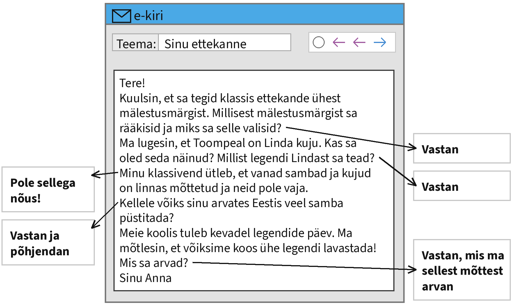

Kirjuta oma kiri siia:

[[___ ___ ___ ___ ___ ___ ___ ___ ___ ___ ___ ___]]

> **Kontrolli enne, kui vajutad „Saada”:** kas vastasid kõigile noolega näidatud märkmetele? Kas kirjas on pöördumine ja lõpetus? Kas tekstis on umbes 100 sõna?

> **NB!** Sinu tekst salvestub ainult sinu enda brauserisse. Õpetaja seda siit ei näe. Kopeeri valmis tekst ja esita see nii, nagu õpetaja ütleb.

#### 2. ülesanne: kokkuvõte diagrammi põhjal

**Loe ülesannet ja kirjuta kokkuvõte allolevasse kasti.**

Kujuta ette, et teie kooli õpilasesindus korraldas 2026. aasta detsembris küsitluse, milles osales 190 õpilast 7.–9. klassist. Näed allpool küsitluse tulemusi diagrammil. Kirjuta nende tulemuste põhjal tekst, milles

- tee vastustest kokkuvõte;
- analüüsi, miks eelistavad paljud noored filmi või raamatut;
- kirjuta, millist tuntud eestlast sina tahaksid meenutada ja kuidas;
- arutle, kuidas muuta mälestusmärgid noortele huvitavamaks.

**Teksti nõutav pikkus on u 160 sõna.**

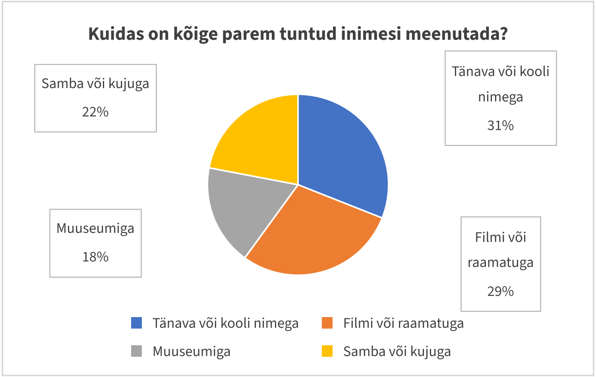

Kirjuta oma kokkuvõte siia:

[[___ ___ ___ ___ ___ ___ ___ ___ ___ ___ ___ ___ ___ ___ ___ ___]]

> **Kontrolli enne, kui vajutad „Saada”:** kas kirjutasid kõigist neljast punktist? Kas kasutasid diagrammi arve? Kas tekstis on umbes 160 sõna?

> **NB!** Sinu tekst salvestub ainult sinu enda brauserisse. Õpetaja seda siit ei näe. Kopeeri valmis tekst ja esita see nii, nagu õpetaja ütleb.

### Lugemine

Lugemisosas on neli ülesannet. Iga ülesanne on eraldi lehel.

#### 2.1 Vestlus

**Täienda Anna ja Jaani vestlust. Kaks vastust jääb üle. Esimene vastus on näidis ja see lünk on juba täidetud.**

_Vali iga vastuse jaoks rippmenüüst sobiv lause ja vajuta „Kontrolli”._

**Anna:** Tere, Jaan! Kas sa oled juba valinud, millisest mälestusmärgist sa ettekande teed?

**Jaan:** _Tere! Jah, ma räägin Linda kujust, mis asub Tallinnas Toompea jalamil._ (näidis)

**Anna:** Linda kujust? Kes see Linda üldse oli?

**Jaan:** 1. [[ Ei, ma ei tea, kus Toompea asub. | See on naine, kes istub kivil ja vaatab kurvalt kaugusesse. | Kuju kavandas skulptor August Weizenberg. | Legendi järgi kandis Linda oma mehe hauale kive. Nii tekkiski Toompea. | Ma käisin eile Toompeal ja seal oli väga palju turiste. | Räägi Kalevipoja kujust Tartus. Ka selle lugu on väga huvitav. | (Linda on eesti muistendite kangelanna, Kalevi naine ja Kalevipoja ema.) ]]

**Anna:** Mis legend temaga seotud on?

**Jaan:** 2. [[ Ei, ma ei tea, kus Toompea asub. | See on naine, kes istub kivil ja vaatab kurvalt kaugusesse. | Kuju kavandas skulptor August Weizenberg. | (Legendi järgi kandis Linda oma mehe hauale kive. Nii tekkiski Toompea.) | Ma käisin eile Toompeal ja seal oli väga palju turiste. | Räägi Kalevipoja kujust Tartus. Ka selle lugu on väga huvitav. | Linda on eesti muistendite kangelanna, Kalevi naine ja Kalevipoja ema. ]]

**Anna:** Huvitav! Kuidas kuju välja näeb?

**Jaan:** 3. [[ Ei, ma ei tea, kus Toompea asub. | (See on naine, kes istub kivil ja vaatab kurvalt kaugusesse.) | Kuju kavandas skulptor August Weizenberg. | Legendi järgi kandis Linda oma mehe hauale kive. Nii tekkiski Toompea. | Ma käisin eile Toompeal ja seal oli väga palju turiste. | Räägi Kalevipoja kujust Tartus. Ka selle lugu on väga huvitav. | Linda on eesti muistendite kangelanna, Kalevi naine ja Kalevipoja ema. ]]

**Anna:** Kes kuju kavandas?

**Jaan:** 4. [[ Ei, ma ei tea, kus Toompea asub. | See on naine, kes istub kivil ja vaatab kurvalt kaugusesse. | (Kuju kavandas skulptor August Weizenberg.) | Legendi järgi kandis Linda oma mehe hauale kive. Nii tekkiski Toompea. | Ma käisin eile Toompeal ja seal oli väga palju turiste. | Räägi Kalevipoja kujust Tartus. Ka selle lugu on väga huvitav. | Linda on eesti muistendite kangelanna, Kalevi naine ja Kalevipoja ema. ]]

**Anna:** Mul on veel raske teemat valida. Mida sa mulle soovitaksid?

**Jaan:** 5. [[ Ei, ma ei tea, kus Toompea asub. | See on naine, kes istub kivil ja vaatab kurvalt kaugusesse. | Kuju kavandas skulptor August Weizenberg. | Legendi järgi kandis Linda oma mehe hauale kive. Nii tekkiski Toompea. | Ma käisin eile Toompeal ja seal oli väga palju turiste. | (Räägi Kalevipoja kujust Tartus. Ka selle lugu on väga huvitav.) | Linda on eesti muistendite kangelanna, Kalevi naine ja Kalevipoja ema. ]]

**Anna:** Hea mõte! Lähen kohe raamatukokku materjali otsima. Aitäh!

#### 2.3 Valikvastused

**Loe teksti ja selle kõrval olevaid küsimusi. Otsusta, milline vastus on õige. Igale küsimusele on üks sobiv vastus. Kõigepealt on näidis ja see on juba ära märgitud.**

_Vali iga küsimuse juures õige vastus ja vajuta „Kontrolli”._

**Legend Ülemiste vanakesest**

Tallinna lähedal asub Ülemiste järv, mis on linnale tähtis joogiveeallikas. Selle järvega on seotud vana legend, mida tunneb peaaegu iga tallinlane.

Legendi järgi elab järve põhjas hall vanamees. Teda kutsutakse Ülemiste vanakeseks. Kord aastas, pimedal sügisööl, tõuseb ta järvest välja ja läheb linna poole.

Linnaväravas küsib vanake valvuritelt alati sama küsimust: „Kas linn on juba valmis?“ Vanakesel on kindel plaan: kui keegi vastab, et linn on valmis, laseb ta kogu järve vee linna peale ja Tallinn upub.

Seepärast vastavad linnavalvurid talle alati: „Ei, linn ei ole veel valmis. Ehitame ikka edasi.“ Vanake raputab kurvalt pead ja läheb tagasi järve, et järgmisel aastal uuesti tulla.

Legend selgitab omal moel, miks Tallinnas kogu aeg midagi ehitatakse. Kui ükskord kõik majad valmis saaksid, oleks linn ohus. Tallinlased räägivad seda lugu naljaga pooleks ka tänapäeval, kui kuskil on jälle teetööd.

Ülemiste järve ääres asub ka suur rändrahn, mida kutsutakse Lindakiviks. Legendi järgi pillas Linda selle maha, kui ta kandis kive Kalevi hauale.

**0. Mis on Ülemiste järv Tallinnale?** (näidis)

- Supelrand.
- **Joogiveeallikas.** ✓
- Kalapüügikoht.

**1. Kes on Ülemiste vanake?**

[(X)] Järve põhjas elav vanamees.
[( )] Vana linnavalvur.
[( )] Tallinna esimene ehitaja.

**2. Millal tuleb vanake linna?**

[( )] Igal kevadel.
[(X)] Kord aastas sügisööl.
[( )] Igal talvehommikul.

**3. Mida vanake valvuritelt küsib?**

[( )] Kas linnas on piisavalt vett.
[(X)] Kas linn on juba valmis.
[( )] Kus elab Linda.

**4. Mis juhtuks, kui keegi vastaks, et linn on valmis?**

[(X)] Linn upuks.
[( )] Vanake jääks linna elama.
[( )] Järv kuivaks ära.

**5. Mida legend selgitab?**

[( )] Miks järves on vähe kala.
[( )] Kuidas tekkis Toompea.
[(X)] Miks Tallinnas pidevalt ehitatakse.

**6. Kuidas räägivad tallinlased legendi tänapäeval?**

[( )] Suure hirmuga.
[(X)] Naljaga pooleks.
[( )] Nad ei räägi seda enam.

**7. Kuidas tekkis legendi järgi Lindakivi?**

[(X)] Linda pillas selle maha.
[( )] Vanake viskas selle järvest välja.
[( )] Valvurid tõid selle linnaväravasse.

#### 2.4 Lünktekst

**Loe katkendit Jaani päevikust ja täida tekstis lüngad. Näidis on sobiva vastusevariandiga juba täidetud. Üks vastusevariant jääb üle.**

_Vali iga lünga jaoks rippmenüüst sobiv jätk ja vajuta „Kontrolli”._

**Minu ettekanne**

Eelmisel nädalal pidin klassi ees tegema ettekande ühest Eesti mälestusmärgist. Valisin A. H. Tammsaare monumendi, **mis asub Tallinna kesklinnas Tammsaare pargis**. Kõigepealt läksin raamatukokku, (1) [[ et neid hiljem esitluses näidata | milles oli juttu Tammsaare elust ja loomingust | millest rääkida ja mis välja jätta | mida peetakse üheks Eesti kirjanduse tähtsamaks teoseks | aga hääl ei värisenud | kus pakuti traditsioonilist eesti toitu | kui olin pildi järgi arvanud | (et leida kirjanikust rohkem infot) | et olin teema põhjalikult läbi töötanud | sest infot oli väga palju | millele oskasin enamasti vastata ]].

Raamatukoguhoidja aitas mul leida raamatuid, (2) [[ et neid hiljem esitluses näidata | (milles oli juttu Tammsaare elust ja loomingust) | millest rääkida ja mis välja jätta | mida peetakse üheks Eesti kirjanduse tähtsamaks teoseks | aga hääl ei värisenud | kus pakuti traditsioonilist eesti toitu | kui olin pildi järgi arvanud | et leida kirjanikust rohkem infot | et olin teema põhjalikult läbi töötanud | sest infot oli väga palju | millele oskasin enamasti vastata ]]. Lugesin, et Tammsaare on kirjutanud romaani „Tõde ja õigus“, (3) [[ et neid hiljem esitluses näidata | milles oli juttu Tammsaare elust ja loomingust | millest rääkida ja mis välja jätta | (mida peetakse üheks Eesti kirjanduse tähtsamaks teoseks) | aga hääl ei värisenud | kus pakuti traditsioonilist eesti toitu | kui olin pildi järgi arvanud | et leida kirjanikust rohkem infot | et olin teema põhjalikult läbi töötanud | sest infot oli väga palju | millele oskasin enamasti vastata ]].

Järgmisel päeval läksin parki monumenti vaatama. Kuju oli palju suurem, (4) [[ et neid hiljem esitluses näidata | milles oli juttu Tammsaare elust ja loomingust | millest rääkida ja mis välja jätta | mida peetakse üheks Eesti kirjanduse tähtsamaks teoseks | aga hääl ei värisenud | kus pakuti traditsioonilist eesti toitu | (kui olin pildi järgi arvanud) | et leida kirjanikust rohkem infot | et olin teema põhjalikult läbi töötanud | sest infot oli väga palju | millele oskasin enamasti vastata ]]. Tegin sellest mitu fotot, (5) [[ (et neid hiljem esitluses näidata) | milles oli juttu Tammsaare elust ja loomingust | millest rääkida ja mis välja jätta | mida peetakse üheks Eesti kirjanduse tähtsamaks teoseks | aga hääl ei värisenud | kus pakuti traditsioonilist eesti toitu | kui olin pildi järgi arvanud | et leida kirjanikust rohkem infot | et olin teema põhjalikult läbi töötanud | sest infot oli väga palju | millele oskasin enamasti vastata ]].

Kodus koostasin esitluse. See oli raske, (6) [[ et neid hiljem esitluses näidata | milles oli juttu Tammsaare elust ja loomingust | millest rääkida ja mis välja jätta | mida peetakse üheks Eesti kirjanduse tähtsamaks teoseks | aga hääl ei värisenud | kus pakuti traditsioonilist eesti toitu | kui olin pildi järgi arvanud | et leida kirjanikust rohkem infot | et olin teema põhjalikult läbi töötanud | (sest infot oli väga palju) | millele oskasin enamasti vastata ]]. Pidin otsustama, (7) [[ et neid hiljem esitluses näidata | milles oli juttu Tammsaare elust ja loomingust | (millest rääkida ja mis välja jätta) | mida peetakse üheks Eesti kirjanduse tähtsamaks teoseks | aga hääl ei värisenud | kus pakuti traditsioonilist eesti toitu | kui olin pildi järgi arvanud | et leida kirjanikust rohkem infot | et olin teema põhjalikult läbi töötanud | sest infot oli väga palju | millele oskasin enamasti vastata ]].

Ettekande ajal olin natuke närvis, (8) [[ et neid hiljem esitluses näidata | milles oli juttu Tammsaare elust ja loomingust | millest rääkida ja mis välja jätta | mida peetakse üheks Eesti kirjanduse tähtsamaks teoseks | (aga hääl ei värisenud) | kus pakuti traditsioonilist eesti toitu | kui olin pildi järgi arvanud | et leida kirjanikust rohkem infot | et olin teema põhjalikult läbi töötanud | sest infot oli väga palju | millele oskasin enamasti vastata ]]. Klassikaaslased kuulasid tähelepanelikult ja esitasid pärast küsimusi, (9) [[ et neid hiljem esitluses näidata | milles oli juttu Tammsaare elust ja loomingust | millest rääkida ja mis välja jätta | mida peetakse üheks Eesti kirjanduse tähtsamaks teoseks | aga hääl ei värisenud | kus pakuti traditsioonilist eesti toitu | kui olin pildi järgi arvanud | et leida kirjanikust rohkem infot | et olin teema põhjalikult läbi töötanud | sest infot oli väga palju | (millele oskasin enamasti vastata) ]]. Õpetaja kiitis mind ja ütles, (10) [[ et neid hiljem esitluses näidata | milles oli juttu Tammsaare elust ja loomingust | millest rääkida ja mis välja jätta | mida peetakse üheks Eesti kirjanduse tähtsamaks teoseks | aga hääl ei värisenud | kus pakuti traditsioonilist eesti toitu | kui olin pildi järgi arvanud | et leida kirjanikust rohkem infot | (et olin teema põhjalikult läbi töötanud) | sest infot oli väga palju | millele oskasin enamasti vastata ]]. Olin enda üle väga uhke.

#### 2.5 Lausete lõpud

**Lõpeta laused. Üks lause lõpp jääb üle. Esimene lause on näidis ja see on juba ära märgitud.**

_Vali iga lünga jaoks rippmenüüst sobiv jätk ja vajuta „Kontrolli”._

**Legend Lindast**

Vanasti elas Eestimaal vägev mees Kalev, **kellel oli naine nimega Linda.** Kalev ja Linda elasid õnnelikult, (1) [[ mis kukkus Ülemiste järve lähedale maha. | mida praegu tuntakse Toompea nime all. | sest Kalevipoeg oli läinud kaugele sõjaretkele. | (kuni Kalev ühel päeval raskelt haigeks jäi.) | ja see asub Ülemiste järve kaldal. | et tuua sinna lilli ja küünlaid. | mille ta tõi kaugelt mererannast. | et kõik inimesed teda kaua mäletaksid. | oli Linda nii kurb, et nuttis päevad ja ööd läbi. | mille kavandas skulptor August Weizenberg. | kuni tema pisaratest tekkis Ülemiste järv. ]] Kui Kalev suri, (2) [[ mis kukkus Ülemiste järve lähedale maha. | mida praegu tuntakse Toompea nime all. | sest Kalevipoeg oli läinud kaugele sõjaretkele. | kuni Kalev ühel päeval raskelt haigeks jäi. | ja see asub Ülemiste järve kaldal. | et tuua sinna lilli ja küünlaid. | mille ta tõi kaugelt mererannast. | et kõik inimesed teda kaua mäletaksid. | (oli Linda nii kurb, et nuttis päevad ja ööd läbi.) | mille kavandas skulptor August Weizenberg. | kuni tema pisaratest tekkis Ülemiste järv. ]] Linda otsustas teha oma mehele suure haua, (3) [[ mis kukkus Ülemiste järve lähedale maha. | mida praegu tuntakse Toompea nime all. | sest Kalevipoeg oli läinud kaugele sõjaretkele. | kuni Kalev ühel päeval raskelt haigeks jäi. | ja see asub Ülemiste järve kaldal. | et tuua sinna lilli ja küünlaid. | mille ta tõi kaugelt mererannast. | (et kõik inimesed teda kaua mäletaksid.) | oli Linda nii kurb, et nuttis päevad ja ööd läbi. | mille kavandas skulptor August Weizenberg. | kuni tema pisaratest tekkis Ülemiste järv. ]] Ta kandis haua peale suuri kive, (4) [[ mis kukkus Ülemiste järve lähedale maha. | mida praegu tuntakse Toompea nime all. | sest Kalevipoeg oli läinud kaugele sõjaretkele. | kuni Kalev ühel päeval raskelt haigeks jäi. | ja see asub Ülemiste järve kaldal. | et tuua sinna lilli ja küünlaid. | (mille ta tõi kaugelt mererannast.) | et kõik inimesed teda kaua mäletaksid. | oli Linda nii kurb, et nuttis päevad ja ööd läbi. | mille kavandas skulptor August Weizenberg. | kuni tema pisaratest tekkis Ülemiste järv. ]] Nii tekkis suur küngas, (5) [[ mis kukkus Ülemiste järve lähedale maha. | (mida praegu tuntakse Toompea nime all.) | sest Kalevipoeg oli läinud kaugele sõjaretkele. | kuni Kalev ühel päeval raskelt haigeks jäi. | ja see asub Ülemiste järve kaldal. | et tuua sinna lilli ja küünlaid. | mille ta tõi kaugelt mererannast. | et kõik inimesed teda kaua mäletaksid. | oli Linda nii kurb, et nuttis päevad ja ööd läbi. | mille kavandas skulptor August Weizenberg. | kuni tema pisaratest tekkis Ülemiste järv. ]] Ühel päeval libises Linda põllest suur kivi, (6) [[ (mis kukkus Ülemiste järve lähedale maha.) | mida praegu tuntakse Toompea nime all. | sest Kalevipoeg oli läinud kaugele sõjaretkele. | kuni Kalev ühel päeval raskelt haigeks jäi. | ja see asub Ülemiste järve kaldal. | et tuua sinna lilli ja küünlaid. | mille ta tõi kaugelt mererannast. | et kõik inimesed teda kaua mäletaksid. | oli Linda nii kurb, et nuttis päevad ja ööd läbi. | mille kavandas skulptor August Weizenberg. | kuni tema pisaratest tekkis Ülemiste järv. ]] Linda istus kivile ja nuttis, (7) [[ mis kukkus Ülemiste järve lähedale maha. | mida praegu tuntakse Toompea nime all. | sest Kalevipoeg oli läinud kaugele sõjaretkele. | kuni Kalev ühel päeval raskelt haigeks jäi. | ja see asub Ülemiste järve kaldal. | et tuua sinna lilli ja küünlaid. | mille ta tõi kaugelt mererannast. | et kõik inimesed teda kaua mäletaksid. | oli Linda nii kurb, et nuttis päevad ja ööd läbi. | mille kavandas skulptor August Weizenberg. | (kuni tema pisaratest tekkis Ülemiste järv.) ]] Seda kivi kutsutakse tänapäeval Lindakiviks (8) [[ mis kukkus Ülemiste järve lähedale maha. | mida praegu tuntakse Toompea nime all. | sest Kalevipoeg oli läinud kaugele sõjaretkele. | kuni Kalev ühel päeval raskelt haigeks jäi. | (ja see asub Ülemiste järve kaldal.) | et tuua sinna lilli ja küünlaid. | mille ta tõi kaugelt mererannast. | et kõik inimesed teda kaua mäletaksid. | oli Linda nii kurb, et nuttis päevad ja ööd läbi. | mille kavandas skulptor August Weizenberg. | kuni tema pisaratest tekkis Ülemiste järv. ]] Linda mälestuseks püstitati Tallinnas Toompea jalamile kuju, (9) [[ mis kukkus Ülemiste järve lähedale maha. | mida praegu tuntakse Toompea nime all. | sest Kalevipoeg oli läinud kaugele sõjaretkele. | kuni Kalev ühel päeval raskelt haigeks jäi. | ja see asub Ülemiste järve kaldal. | et tuua sinna lilli ja küünlaid. | mille ta tõi kaugelt mererannast. | et kõik inimesed teda kaua mäletaksid. | oli Linda nii kurb, et nuttis päevad ja ööd läbi. | (mille kavandas skulptor August Weizenberg.) | kuni tema pisaratest tekkis Ülemiste järv. ]] Kuju juures käivad inimesed ka praegu, (10) [[ mis kukkus Ülemiste järve lähedale maha. | mida praegu tuntakse Toompea nime all. | sest Kalevipoeg oli läinud kaugele sõjaretkele. | kuni Kalev ühel päeval raskelt haigeks jäi. | ja see asub Ülemiste järve kaldal. | (et tuua sinna lilli ja küünlaid.) | mille ta tõi kaugelt mererannast. | et kõik inimesed teda kaua mäletaksid. | oli Linda nii kurb, et nuttis päevad ja ööd läbi. | mille kavandas skulptor August Weizenberg. | kuni tema pisaratest tekkis Ülemiste järv. ]]

### Keelestruktuur

Keelestruktuuri osas on kaks ülesannet. Iga ülesanne on eraldi lehel.

#### 2.6 Vali sobiv sõna

**Loe teksti ja vali lünka sobiv sõna. Esimene lünk on näidis ja seal on õige vastus ära valitud.**

_Vali iga lünga jaoks rippmenüüst sobiv sõna ja vajuta „Kontrolli”._

**Lydia Koidula**

Lydia Koidula on üks **tuntumaid** Eesti luuletajaid. Ta sündis [[ 1843. aasta | 1843. aastat | (1843. aastal) ]] Vändras.

Koidula isa oli ajakirjanik Johann Voldemar Jannsen ja tütar [[ aitab | (aitas) | aidanud ]] teda ajalehe tegemisel. Koidula kirjutas palju [[ luuletustes | luuletused | (luuletusi) ]] eesti rahvast ja kodumaast. Tema luuletust „Mu isamaa on minu arm“ [[ laulab | (lauldakse) | laulnud ]] tänapäevalgi laulupidudel.

Koidula kirjutas ka esimese eestikeelse [[ näidend | näidendit | (näidendi) ]] „Saaremaa onupoeg“, mis [[ (etendati) | etendama | etendab ]] 1870. aastal. Pärast abiellumist kolis Koidula Kroonlinna, [[ kust | (kus) | kuhu ]] ta elas kuni oma surmani.

Pärnus seisab Koidula mälestussammas, mille juurde [[ läheb | (lähevad) | minema ]] kooliõpilased lilli viimas. Koidula portree [[ (oli) | olnud | olid ]] ka Eesti saja krooni rahatähel. Tema elu ja loomingut õpitakse koolis ka [[ praegust | (praegu) | praegune ]].

#### 2.7 Sõna õige vorm

**Loe teksti ja kirjuta lünka sõna õige vorm. Igas lüngas on antud sõna algvorm, pane see sellisesse vormi, mis sobib teksti. Esimene lünk on näidis: sulgudes on sõna algvorm ja selle kõrval lünka sobiv vorm.**

_Kirjuta sulgudes oleva sõna õige vorm lünka ja vajuta „Kontrolli”._

**Mälestusmärgid minu kodulinnas**

Minu kodulinnas Tartus on palju _(mälestusmärk)_ **mälestusmärke**. Kõige _(tuntud)_ [[tuntum]] on vist suudlevate tudengite skulptuur, mis seisab _(raekoda)_ [[raekoja]] ees. Emajõe kaldal seisab _(Kalevipoeg)_ [[Kalevipoja]] kuju. Kuju hävitati nõukogude ajal, kuid see _(taastama)_ [[taastati]] 2003. aastal.

Toomemäel on mitme kuulsa _(teadlane)_ [[teadlase]] mälestusmärk. Tudengid peavad Karl Ernst von Baeri kujust lugu ja _(pesema)_ [[pesevad]] igal kevadel tema pead šampusega. Seda traditsiooni jälgivad igal aastal paljud _(pealtvaataja)_ [[pealtvaatajad]].

Minu arvates teevad mälestusmärgid linna _(huvitav)_ [[huvitavamaks]] ja aitavad meil meeles pidada _(tähtis)_ [[tähtsaid]] inimesi. Soovitan kõigil Tartut külastada ja neid kujusid oma _(silm)_ [[silmaga]] näha.

## Tänavad

**Töölehed PDF-ina (printimiseks):** [Kirjutamine](tanavad_kirjutamine.pdf) · [Lugemine](tanavad_lugemine.pdf) · [Keelestruktuur](tanavad_keelestruktuur.pdf) · [Kõik koos](tanavad_koik_toolehed.pdf)

### Kirjutamine

#### 1. ülesanne: kiri

**Loe ülesannet ja kirjuta oma vastus allolevasse kasti.**

Kujuta ette, et sinu sõber Kaarel elab Tartus. Ta tuleb nädalavahetusel sulle Tallinna külla ja kirjutab sulle. Loe tema kirja ja vasta sellele noolega näidatud märkmete järgi. Kasuta kõiki märkmeid. **Teksti pikkus peab olema u 100 sõna.**

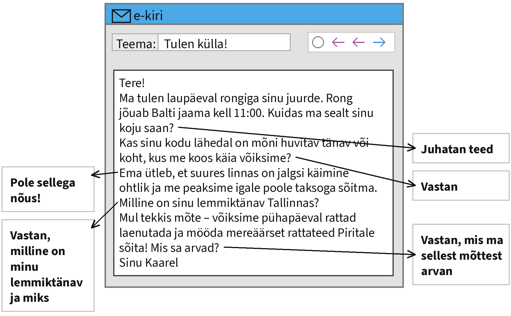

Kirjuta oma kiri siia:

[[___ ___ ___ ___ ___ ___ ___ ___ ___ ___ ___ ___]]

> **Kontrolli enne, kui vajutad „Saada”:** kas vastasid kõigile noolega näidatud märkmetele? Kas kirjas on pöördumine ja lõpetus? Kas tekstis on umbes 100 sõna?

> **NB!** Sinu tekst salvestub ainult sinu enda brauserisse. Õpetaja seda siit ei näe. Kopeeri valmis tekst ja esita see nii, nagu õpetaja ütleb.

#### 2. ülesanne: kokkuvõte diagrammi põhjal

**Loe ülesannet ja kirjuta kokkuvõte allolevasse kasti.**

Kujuta ette, et teie kooli õpilasesindus korraldas 2026. aasta detsembris küsitluse, milles osales 230 õpilast 7.–9. klassist. Näed allpool küsitluse tulemusi diagrammil. Kirjuta nende tulemuste põhjal tekst, milles

- tee vastustest kokkuvõte;
- analüüsi, miks tulevad nii vähesed õpilased kooli ratta või tõukerattaga;
- kirjuta, kuidas sina kooli tuled ning mis sulle selle juures meeldib või ei meeldi;
- arutle, kuidas muuta kooli ümbruse tänavad õpilastele turvalisemaks.

**Teksti nõutav pikkus on u 160 sõna.**

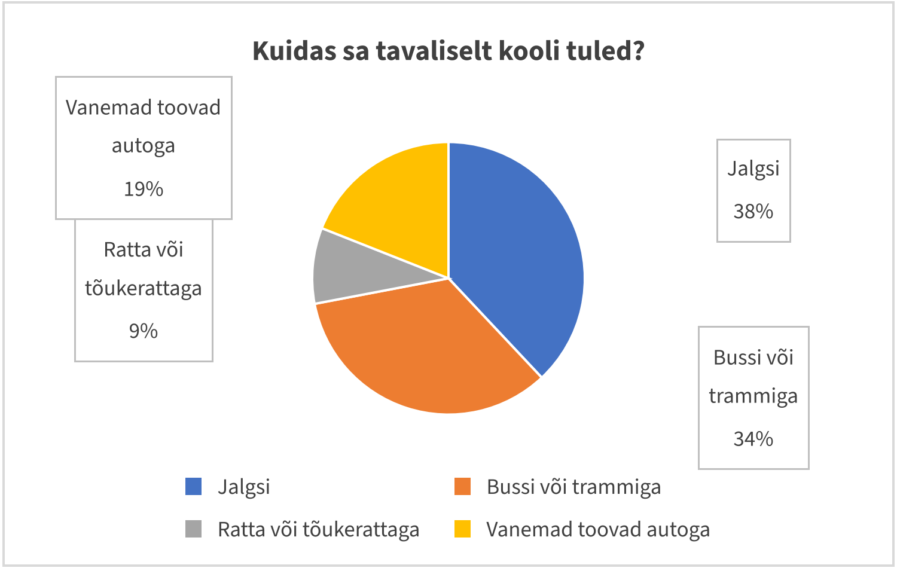

Kirjuta oma kokkuvõte siia:

[[___ ___ ___ ___ ___ ___ ___ ___ ___ ___ ___ ___ ___ ___ ___ ___]]

> **Kontrolli enne, kui vajutad „Saada”:** kas kirjutasid kõigist neljast punktist? Kas kasutasid diagrammi arve? Kas tekstis on umbes 160 sõna?

> **NB!** Sinu tekst salvestub ainult sinu enda brauserisse. Õpetaja seda siit ei näe. Kopeeri valmis tekst ja esita see nii, nagu õpetaja ütleb.

### Lugemine

Lugemisosas on neli ülesannet. Iga ülesanne on eraldi lehel.

#### 2.1 Vestlus

**Täienda Turisti ja Mia vestlust. Kaks vastust jääb üle. Esimene vastus on näidis ja see lünk on juba täidetud.**

_Vali iga vastuse jaoks rippmenüüst sobiv lause ja vajuta „Kontrolli”._

**Turist:** Vabandage! Kas te oskate öelda, kuidas ma saan siit Balti jaama?

**Mia:** _Muidugi. Te olete praegu Vabaduse väljakul. Balti jaama on siit umbes kahekümneminutiline jalutuskäik._ (näidis)

**Turist:** Kakskümmend minutit? Kas sinna saab ka bussiga?

**Mia:** 1. [[ Mulle meeldib rohkem talvel suusatada. | Siis minge läbi Toompargi, tiigist mööda. Pargi lõpus näete juba raudteejaama. | Jaama kõrval on Balti jaama turg. Seal saab süüa ja osta suveniire. | Ei, rong sõitis juba eile õhtul ära. | Jah, olen sündinud ja kasvanud Tallinnas. Tunnen siin iga tänavat. | (Saab küll, aga jala on peaaegu sama kiire, sest bussipeatus on kaugel.) | Minge otse mööda seda tänavat, kuni näete Toompea mäge. ]]

**Turist:** Hästi, siis lähen jala. Kuhu poole ma pean minema?

**Mia:** 2. [[ Mulle meeldib rohkem talvel suusatada. | Siis minge läbi Toompargi, tiigist mööda. Pargi lõpus näete juba raudteejaama. | Jaama kõrval on Balti jaama turg. Seal saab süüa ja osta suveniire. | Ei, rong sõitis juba eile õhtul ära. | Jah, olen sündinud ja kasvanud Tallinnas. Tunnen siin iga tänavat. | Saab küll, aga jala on peaaegu sama kiire, sest bussipeatus on kaugel. | (Minge otse mööda seda tänavat, kuni näete Toompea mäge.) ]]

**Turist:** Toompea poole. Ja mis edasi?

**Mia:** 3. [[ Mulle meeldib rohkem talvel suusatada. | (Siis minge läbi Toompargi, tiigist mööda. Pargi lõpus näete juba raudteejaama.) | Jaama kõrval on Balti jaama turg. Seal saab süüa ja osta suveniire. | Ei, rong sõitis juba eile õhtul ära. | Jah, olen sündinud ja kasvanud Tallinnas. Tunnen siin iga tänavat. | Saab küll, aga jala on peaaegu sama kiire, sest bussipeatus on kaugel. | Minge otse mööda seda tänavat, kuni näete Toompea mäge. ]]

**Turist:** Kas jaama juures on ka midagi huvitavat vaadata?

**Mia:** 4. [[ Mulle meeldib rohkem talvel suusatada. | Siis minge läbi Toompargi, tiigist mööda. Pargi lõpus näete juba raudteejaama. | (Jaama kõrval on Balti jaama turg. Seal saab süüa ja osta suveniire.) | Ei, rong sõitis juba eile õhtul ära. | Jah, olen sündinud ja kasvanud Tallinnas. Tunnen siin iga tänavat. | Saab küll, aga jala on peaaegu sama kiire, sest bussipeatus on kaugel. | Minge otse mööda seda tänavat, kuni näete Toompea mäge. ]]

**Turist:** Suur aitäh! Kas te olete ise ka siit pärit?

**Mia:** 5. [[ Mulle meeldib rohkem talvel suusatada. | Siis minge läbi Toompargi, tiigist mööda. Pargi lõpus näete juba raudteejaama. | Jaama kõrval on Balti jaama turg. Seal saab süüa ja osta suveniire. | Ei, rong sõitis juba eile õhtul ära. | (Jah, olen sündinud ja kasvanud Tallinnas. Tunnen siin iga tänavat.) | Saab küll, aga jala on peaaegu sama kiire, sest bussipeatus on kaugel. | Minge otse mööda seda tänavat, kuni näete Toompea mäge. ]]

**Turist:** Te olete väga lahke. Head päeva teile!

#### 2.3 Valikvastused

**Loe teksti ja selle kõrval olevaid küsimusi. Otsusta, milline vastus on õige. Igale küsimusele on üks sobiv vastus. Kõigepealt on näidis ja see on juba ära märgitud.**

_Vali iga küsimuse juures õige vastus ja vajuta „Kontrolli”._

**Tallinna vanalinna tänavad**

Tallinna vanalinn on üks paremini säilinud keskaegseid linnu Euroopas. 1997. aastal võeti see UNESCO maailmapärandi nimekirja. Vanalinna kitsastel tänavatel jalutades on tunne, nagu oleks aeg sajandeid tagasi pöördunud.

Vanalinn jaguneb kaheks: all-linnaks ja Toompeaks. Vanasti elasid Toompeal aadlikud ja võimukandjad, all-linnas aga kaupmehed ja käsitöölised. Kaks linnaosa ei saanud alati omavahel läbi ja nende vahel oli koguni värav, mis öösiti suleti.

All-linna ja Toompead ühendavad kaks tänavat: Pikk jalg ja Lühike jalg. Pikk jalg on lauge ja mööda seda said vanasti sõita ka hobusevankrid. Lühike jalg on aga järsk ja koosneb peamiselt treppidest, nii et seal saab liikuda ainult jalgsi.

Vanalinna pikim tänav on Pikk tänav. See lõpeb Paksu Margareeta torni juures, kus asub praegu meremuuseum. Tänava ääres on palju uhkeid kaupmeeste maju.

Paljud turistid jalutavad ka Katariina käigus. See kitsas tänav ühendab Vene ja Müürivahe tänavat. Käigu ääres asuvad käsitöökojad, kus saab vaadata, kuidas valmivad klaasist, keraamikast ja nahast esemed.

Vanalinnas jalutades tasub kanda mugavaid jalanõusid. Enamik tänavaid on kaetud munakividega ja kõrgete kontsadega on neil raske käia. Vihmase ilmaga võivad kivid olla ka libedad.

**0. Millal võeti Tallinna vanalinn UNESCO maailmapärandi nimekirja?** (näidis)

- 1979. aastal.
- **1997. aastal.** ✓
- 2007. aastal.

**1. Kes elasid vanasti Toompeal?**

[( )] Kalurid.
[(X)] Aadlikud ja võimukandjad.
[( )] Kaupmehed ja käsitöölised.

**2. Mis oli all-linna ja Toompea vahel?**

[( )] Lai jõgi.
[(X)] Värav, mis öösiti suleti.
[( )] Suur turuplats.

**3. Mille poolest erineb Lühike jalg Pikast jalast?**

[(X)] See koosneb peamiselt treppidest.
[( )] See on pikem.
[( )] See on laiem.

**4. Kus lõpeb Pikk tänav?**

[( )] Raekoja platsil.
[( )] Viru väravas.
[(X)] Paksu Margareeta torni juures.

**5. Mida saab teha Katariina käigus?**

[( )] Süüa restoranis.
[(X)] Vaadata käsitööliste tööd.
[( )] Osta riideid.

**6. Miks tasub vanalinnas kanda mugavaid jalanõusid?**

[(X)] Sest tänavad on munakividega.
[( )] Sest tänavad on väga pikad.
[( )] Sest seal ei sõida busse.

**7. Mis juhtub munakividega vihmase ilmaga?**

[( )] Need muutuvad tumedaks.
[( )] Need lähevad katki.
[(X)] Need muutuvad libedaks.

#### 2.4 Lünktekst

**Loe katkendit Robini blogist ja täida tekstis lüngad. Näidis on sobiva vastusevariandiga juba täidetud. Üks vastusevariant jääb üle.**

_Vali iga lünga jaoks rippmenüüst sobiv jätk ja vajuta „Kontrolli”._

**Minu esimene koolipäev uues linnas**

Kui me perega Tartusse kolisime, **ei teadnud ma seal mitte ühtegi tänavat**. Esimesel koolipäeval otsustasin minna kooli jala, (1) [[ sest buss sõitis otse kooli ette | kuidas kodust kooli jõuda | seega ei saanud ma kaarti vaadata | (kuigi ema pakkus, et viib mind autoga) | millest peab mööda minema ja kus pöörama | kus ma polnud kunagi varem käinud | ja tund oli juba alanud | kes ei tea, kuidas kuhugi minna | nii et pidin minema teist teed pidi | kes jalutas jõe ääres oma koeraga | sest ka tema oli kunagi uues linnas ära eksinud ]]. Õhtul enne olin kaardilt vaadanud, (2) [[ sest buss sõitis otse kooli ette | (kuidas kodust kooli jõuda) | seega ei saanud ma kaarti vaadata | kuigi ema pakkus, et viib mind autoga | millest peab mööda minema ja kus pöörama | kus ma polnud kunagi varem käinud | ja tund oli juba alanud | kes ei tea, kuidas kuhugi minna | nii et pidin minema teist teed pidi | kes jalutas jõe ääres oma koeraga | sest ka tema oli kunagi uues linnas ära eksinud ]]. Tundus lihtne: pidin minema mööda Riia tänavat ja pöörama siis paremale.

Hommikul läks aga kõik teisiti. Riia tänaval olid teetööd, (3) [[ sest buss sõitis otse kooli ette | kuidas kodust kooli jõuda | seega ei saanud ma kaarti vaadata | kuigi ema pakkus, et viib mind autoga | millest peab mööda minema ja kus pöörama | kus ma polnud kunagi varem käinud | ja tund oli juba alanud | kes ei tea, kuidas kuhugi minna | (nii et pidin minema teist teed pidi) | kes jalutas jõe ääres oma koeraga | sest ka tema oli kunagi uues linnas ära eksinud ]]. Ümbersõiduteed järgides jõudsin hoopis Emajõe äärde, (4) [[ sest buss sõitis otse kooli ette | kuidas kodust kooli jõuda | seega ei saanud ma kaarti vaadata | kuigi ema pakkus, et viib mind autoga | millest peab mööda minema ja kus pöörama | (kus ma polnud kunagi varem käinud) | ja tund oli juba alanud | kes ei tea, kuidas kuhugi minna | nii et pidin minema teist teed pidi | kes jalutas jõe ääres oma koeraga | sest ka tema oli kunagi uues linnas ära eksinud ]].

Telefonil oli aku tühi, (5) [[ sest buss sõitis otse kooli ette | kuidas kodust kooli jõuda | (seega ei saanud ma kaarti vaadata) | kuigi ema pakkus, et viib mind autoga | millest peab mööda minema ja kus pöörama | kus ma polnud kunagi varem käinud | ja tund oli juba alanud | kes ei tea, kuidas kuhugi minna | nii et pidin minema teist teed pidi | kes jalutas jõe ääres oma koeraga | sest ka tema oli kunagi uues linnas ära eksinud ]]. Küsisin teed ühelt vanaproualt, (6) [[ sest buss sõitis otse kooli ette | kuidas kodust kooli jõuda | seega ei saanud ma kaarti vaadata | kuigi ema pakkus, et viib mind autoga | millest peab mööda minema ja kus pöörama | kus ma polnud kunagi varem käinud | ja tund oli juba alanud | kes ei tea, kuidas kuhugi minna | nii et pidin minema teist teed pidi | (kes jalutas jõe ääres oma koeraga) | sest ka tema oli kunagi uues linnas ära eksinud ]]. Vanaproua seletas mulle väga täpselt, (7) [[ sest buss sõitis otse kooli ette | kuidas kodust kooli jõuda | seega ei saanud ma kaarti vaadata | kuigi ema pakkus, et viib mind autoga | (millest peab mööda minema ja kus pöörama) | kus ma polnud kunagi varem käinud | ja tund oli juba alanud | kes ei tea, kuidas kuhugi minna | nii et pidin minema teist teed pidi | kes jalutas jõe ääres oma koeraga | sest ka tema oli kunagi uues linnas ära eksinud ]]. Ta ütles, et pean minema üle Kaarsilla ja siis Raekoja platsist mööda.

Lõpuks jõudsin kooli kümme minutit hiljem (8) [[ sest buss sõitis otse kooli ette | kuidas kodust kooli jõuda | seega ei saanud ma kaarti vaadata | kuigi ema pakkus, et viib mind autoga | millest peab mööda minema ja kus pöörama | kus ma polnud kunagi varem käinud | (ja tund oli juba alanud) | kes ei tea, kuidas kuhugi minna | nii et pidin minema teist teed pidi | kes jalutas jõe ääres oma koeraga | sest ka tema oli kunagi uues linnas ära eksinud ]]. Õpetaja ei pahandanud, (9) [[ sest buss sõitis otse kooli ette | kuidas kodust kooli jõuda | seega ei saanud ma kaarti vaadata | kuigi ema pakkus, et viib mind autoga | millest peab mööda minema ja kus pöörama | kus ma polnud kunagi varem käinud | ja tund oli juba alanud | kes ei tea, kuidas kuhugi minna | nii et pidin minema teist teed pidi | kes jalutas jõe ääres oma koeraga | (sest ka tema oli kunagi uues linnas ära eksinud) ]]. Nüüd tunnen Tartu kesklinna juba väga hästi ja aitan ise turiste, (10) [[ sest buss sõitis otse kooli ette | kuidas kodust kooli jõuda | seega ei saanud ma kaarti vaadata | kuigi ema pakkus, et viib mind autoga | millest peab mööda minema ja kus pöörama | kus ma polnud kunagi varem käinud | ja tund oli juba alanud | (kes ei tea, kuidas kuhugi minna) | nii et pidin minema teist teed pidi | kes jalutas jõe ääres oma koeraga | sest ka tema oli kunagi uues linnas ära eksinud ]].

#### 2.5 Lausete lõpud

**Lõpeta laused. Üks lause lõpp jääb üle. Esimene lause on näidis ja see on juba ära märgitud.**

_Vali iga lünga jaoks rippmenüüst sobiv jätk ja vajuta „Kontrolli”._

**Kuidas meie juurde tulla**

Kui sa tuled bussiga, **välju peatuses „Kesklinn“.** Bussist väljudes vaata ringi, (1) [[ näed paremal pool apteeki. | millest pead läbi minema. | muidu ei pääse sa trepikotta. | helista mulle ja ma tulen sulle vastu. | (sest peatuse vastas on suur purskkaev.) | kuni jõuad punase telliskivimajani. | ja pööra esimesel ristmikul vasakule. | sest pargis on talvel liuväli. | ja sellel on sinine välisuks. | mille aknal on alati palju värvilisi raamatuid. | kus tuleb oodata rohelist tuld. ]] Mine purskkaevust mööda (2) [[ näed paremal pool apteeki. | millest pead läbi minema. | muidu ei pääse sa trepikotta. | helista mulle ja ma tulen sulle vastu. | sest peatuse vastas on suur purskkaev. | kuni jõuad punase telliskivimajani. | (ja pööra esimesel ristmikul vasakule.) | sest pargis on talvel liuväli. | ja sellel on sinine välisuks. | mille aknal on alati palju värvilisi raamatuid. | kus tuleb oodata rohelist tuld. ]] Kõnni otse umbes sada meetrit, (3) [[ näed paremal pool apteeki. | millest pead läbi minema. | muidu ei pääse sa trepikotta. | helista mulle ja ma tulen sulle vastu. | sest peatuse vastas on suur purskkaev. | (kuni jõuad punase telliskivimajani.) | ja pööra esimesel ristmikul vasakule. | sest pargis on talvel liuväli. | ja sellel on sinine välisuks. | mille aknal on alati palju värvilisi raamatuid. | kus tuleb oodata rohelist tuld. ]] Punase maja kõrval on väike park, (4) [[ näed paremal pool apteeki. | (millest pead läbi minema.) | muidu ei pääse sa trepikotta. | helista mulle ja ma tulen sulle vastu. | sest peatuse vastas on suur purskkaev. | kuni jõuad punase telliskivimajani. | ja pööra esimesel ristmikul vasakule. | sest pargis on talvel liuväli. | ja sellel on sinine välisuks. | mille aknal on alati palju värvilisi raamatuid. | kus tuleb oodata rohelist tuld. ]] Pargi lõpus on ülekäigurada, (5) [[ näed paremal pool apteeki. | millest pead läbi minema. | muidu ei pääse sa trepikotta. | helista mulle ja ma tulen sulle vastu. | sest peatuse vastas on suur purskkaev. | kuni jõuad punase telliskivimajani. | ja pööra esimesel ristmikul vasakule. | sest pargis on talvel liuväli. | ja sellel on sinine välisuks. | mille aknal on alati palju värvilisi raamatuid. | (kus tuleb oodata rohelist tuld.) ]] Kui oled üle tee läinud, (6) [[ (näed paremal pool apteeki.) | millest pead läbi minema. | muidu ei pääse sa trepikotta. | helista mulle ja ma tulen sulle vastu. | sest peatuse vastas on suur purskkaev. | kuni jõuad punase telliskivimajani. | ja pööra esimesel ristmikul vasakule. | sest pargis on talvel liuväli. | ja sellel on sinine välisuks. | mille aknal on alati palju värvilisi raamatuid. | kus tuleb oodata rohelist tuld. ]] Apteegi kõrval on raamatupood, (7) [[ näed paremal pool apteeki. | millest pead läbi minema. | muidu ei pääse sa trepikotta. | helista mulle ja ma tulen sulle vastu. | sest peatuse vastas on suur purskkaev. | kuni jõuad punase telliskivimajani. | ja pööra esimesel ristmikul vasakule. | sest pargis on talvel liuväli. | ja sellel on sinine välisuks. | (mille aknal on alati palju värvilisi raamatuid.) | kus tuleb oodata rohelist tuld. ]] Meie maja asub raamatupoe vastas (8) [[ näed paremal pool apteeki. | millest pead läbi minema. | muidu ei pääse sa trepikotta. | helista mulle ja ma tulen sulle vastu. | sest peatuse vastas on suur purskkaev. | kuni jõuad punase telliskivimajani. | ja pööra esimesel ristmikul vasakule. | sest pargis on talvel liuväli. | (ja sellel on sinine välisuks.) | mille aknal on alati palju värvilisi raamatuid. | kus tuleb oodata rohelist tuld. ]] Kui sa ei leia maja üles, (9) [[ näed paremal pool apteeki. | millest pead läbi minema. | muidu ei pääse sa trepikotta. | (helista mulle ja ma tulen sulle vastu.) | sest peatuse vastas on suur purskkaev. | kuni jõuad punase telliskivimajani. | ja pööra esimesel ristmikul vasakule. | sest pargis on talvel liuväli. | ja sellel on sinine välisuks. | mille aknal on alati palju värvilisi raamatuid. | kus tuleb oodata rohelist tuld. ]] Ära unusta, et uksekood on 2025, (10) [[ näed paremal pool apteeki. | millest pead läbi minema. | (muidu ei pääse sa trepikotta.) | helista mulle ja ma tulen sulle vastu. | sest peatuse vastas on suur purskkaev. | kuni jõuad punase telliskivimajani. | ja pööra esimesel ristmikul vasakule. | sest pargis on talvel liuväli. | ja sellel on sinine välisuks. | mille aknal on alati palju värvilisi raamatuid. | kus tuleb oodata rohelist tuld. ]]

### Keelestruktuur

Keelestruktuuri osas on kaks ülesannet. Iga ülesanne on eraldi lehel.

#### 2.6 Vali sobiv sõna

**Loe teksti ja vali lünka sobiv sõna. Esimene lünk on näidis ja seal on õige vastus ära valitud.**

_Vali iga lünga jaoks rippmenüüst sobiv sõna ja vajuta „Kontrolli”._

**Tänavanimed räägivad ajaloost**

Paljude **tänavate** nimed räägivad oma linna ajaloost. Tallinna vanalinnas on tänavaid, mis [[ sai | (said) | saanud ]] oma nime juba keskajal.

Näiteks Kullassepa tänaval elasid ja töötasid vanasti [[ kullasseppi | kullasseppade | (kullassepad) ]]. Vene tänaval asusid vene [[ kaupmehed | (kaupmeeste) | kaupmehi ]] kauplused ja kirik. Müürivahe tänav sai nime sellepärast, et see asub kahe [[ müür | müüride | (müüri) ]] vahel.

Uuemates linnaosades on tänavad sageli nimetatud tuntud [[ (inimeste) | inimesi | inimesed ]] järgi. Tallinnas on näiteks Tammsaare tee ja Koidula tänav. Mõnikord nimetatakse tänavaid ka [[ puid | (puude) | puud ]] või lillede järgi, näiteks Kase, Pärna või Roosi tänav.

Mõne tänava nimi on [[ aeg jooksul | (aja jooksul) | aega jooksul ]] mitu korda muutunud. Kui oled uues linnas, tasub tänavanimesid tähelepanelikult [[ (lugeda) | loeb | lugema ]]. Need aitavad [[ leiab | (leida) | leidma ]] õige tee ja jutustavad ka linna [[ (lugusid) | lugude | lood ]].

#### 2.7 Sõna õige vorm

**Loe teksti ja kirjuta lünka sõna õige vorm. Igas lüngas on antud sõna algvorm, pane see sellisesse vormi, mis sobib teksti. Esimene lünk on näidis: sulgudes on sõna algvorm ja selle kõrval lünka sobiv vorm.**

_Kirjuta sulgudes oleva sõna õige vorm lünka ja vajuta „Kontrolli”._

**Minu koolitee**

Minu kodu asub _(linn)_ **linna** serval ja kooli on umbes kaks kilomeetrit. Igal hommikul _(väljuma)_ [[väljun]] kodust kell pool kaheksa. Kõigepealt kõnnin mööda vaikset _(kõrvaltänav)_ [[kõrvaltänavat]], kuni jõuan suure _(ristmik)_ [[ristmikuni]]. Seal tuleb alati oodata, sest _(auto)_ [[autosid]] on väga palju.

Ristmikult pööran _(vasak)_ [[vasakule]] ja lähen läbi _(park)_ [[pargi]]. Pargis kohtan sageli oma _(klassivend)_ [[klassivenda]] ja ülejäänud tee kõnnime koos _(tema)_ [[temaga]]. Mõnikord sõidame bussiga, kui väljas sajab _(vihm)_ [[vihma]]. Kooli jõuame tavaliselt viis minutit enne _(tund)_ [[tundi]].

## E-eksami näidisülesanded

Need on e-eksami näidisülesanded. Lugemise ja keelestruktuuri ülesanded on siin ainult PDF-ina.

**Töölehed PDF-ina (printimiseks):** [Kirjutamine](eis_naidised_kirjutamine.pdf) · [Lugemine](eis_naidised_lugemine.pdf) · [Keelestruktuur](eis_naidised_keelestruktuur.pdf) · [Kõik koos](eis_naidised_koik_toolehed.pdf)

### Kirjutamine

#### 1. ülesanne: kiri

**Loe ülesannet ja kirjuta oma vastus allolevasse kasti.**

Kujuta ette, et käisid „Eesti otsib superstaari“ finaalkontserdil. Sinu sõber ei saanud kontserdile tulla ja ta tahab nüüd teada, millised muljed sulle jäid. Loe tema kirja (vt allpool) ja vasta sellele noolega näidatud märkmete järgi. Kasuta kõiki märkmeid. **Teksti pikkus peab olema u 100 sõna.**

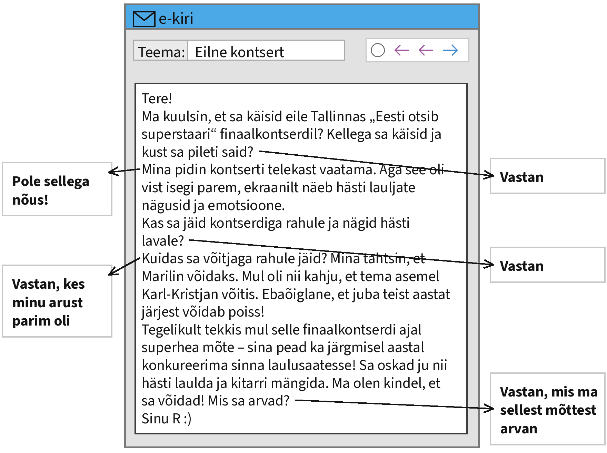

Kirjuta oma kiri siia:

[[___ ___ ___ ___ ___ ___ ___ ___ ___ ___ ___ ___]]

> **Kontrolli enne, kui vajutad „Saada”:** kas vastasid kõigile noolega näidatud märkmetele? Kas kirjas on pöördumine ja lõpetus? Kas tekstis on umbes 100 sõna?

> **NB!** Sinu tekst salvestub ainult sinu enda brauserisse. Õpetaja seda siit ei näe. Kopeeri valmis tekst ja esita see nii, nagu õpetaja ütleb.

#### 2. ülesanne: kokkuvõte diagrammi põhjal

**Loe ülesannet ja kirjuta kokkuvõte allolevasse kasti.**

Lõunaleht korraldas 2024. aastal oma lugejate seas küsitluse, milles osales 1752 inimest. Näed allpool küsitluse tulemusi diagrammil. Kirjuta nende tulemuste põhjal tekst, milles

- tee vastustest kokkuvõte;
- analüüsi, miks inimesi, kes üldse raamatukogus ei käi, on nii palju;
- kirjuta, kas eelistad raamatuid osta või laenutada ja miks;
- arutle, kuidas võiks raamatukogud endale rohkem külastajaid saada.

**Teksti nõutav pikkus on u 160 sõna.**

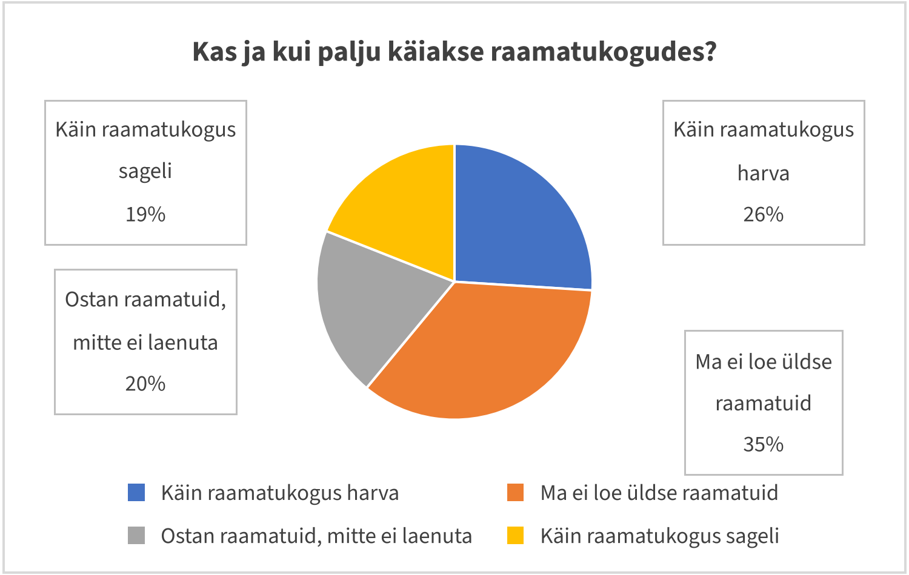

Kirjuta oma kokkuvõte siia:

[[___ ___ ___ ___ ___ ___ ___ ___ ___ ___ ___ ___ ___ ___ ___ ___]]

> **Kontrolli enne, kui vajutad „Saada”:** kas kirjutasid kõigist neljast punktist? Kas kasutasid diagrammi arve? Kas tekstis on umbes 160 sõna?

> **NB!** Sinu tekst salvestub ainult sinu enda brauserisse. Õpetaja seda siit ei näe. Kopeeri valmis tekst ja esita see nii, nagu õpetaja ütleb.
